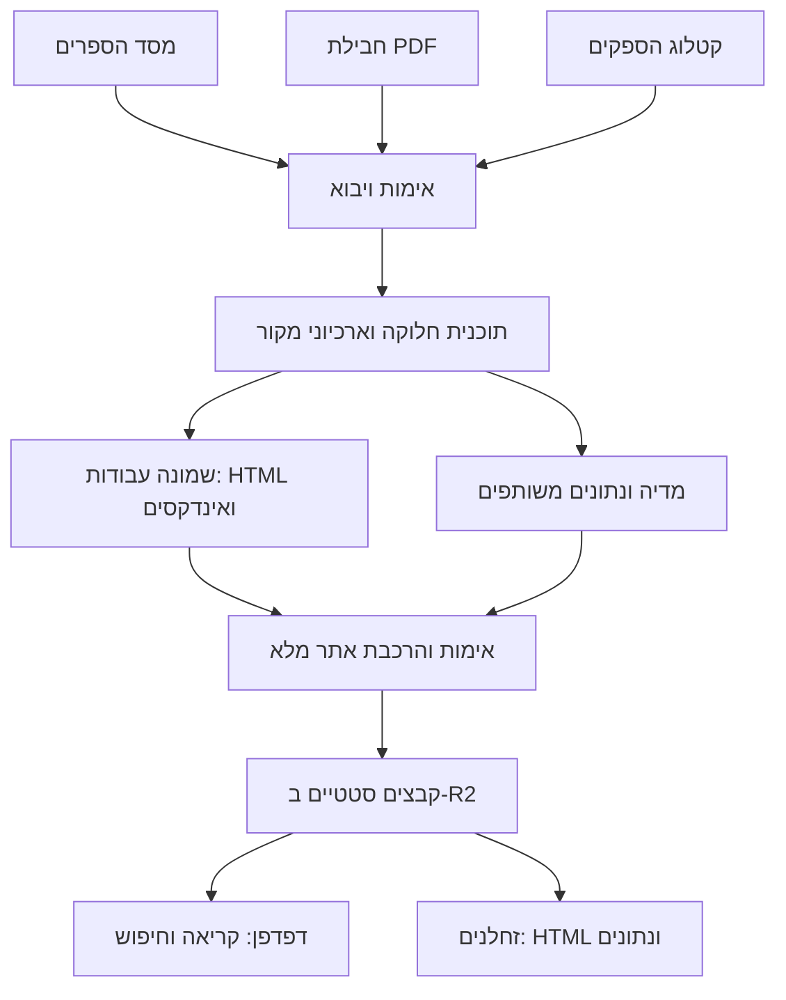

# מבנה המערכת

## עיקרון העבודה

האתר נבנה מראש מתוך ההפצה הרשמית של אוצריא. המשתמש והזחלן מקבלים אותו HTML מלא, עם קישורים רגילים בין קטגוריות, ספרים ומקטעי קריאה. JavaScript משפר חיפוש ואפשרויות קריאה; הוא אינו תנאי לקבלת הטקסט.

אין שירות חיפוש בצד שרת, ואין שליפת ספר שלם לתוך הדפדפן כדי להציג פסקה אחת. מקור האמת אינו רשימת ספרים ידנית ב-README.

## מקור הנתונים ועדכונים

פרופיל `full` משתמש בהפצה הרשמית של [Otzaria/SeforimLibrary](https://github.com/Otzaria/SeforimLibrary), המשמשת את תשתית העדכון של אוצריא ומרכזת את טקסטי המקורות. זו דרך לשמור על התאמה להרכב ולמבנה שהפרויקט עצמו מפיץ, במקום לבצע יבוא עצמאי חלקי מכל מאגר צדדי.

היבוא שומר גרסת מקור, שייכות לספר, מחבר, קטגוריות, כותרות ומידע ייחוס. כל טקסטי ההפצה נכללים בפרופיל המלא; שדות רישיון וייחוס מתארים את המקור ואינם מסנן שמצמצם את היקף הספרייה. פרופיל `starter` נועד לפיתוח ולבדיקות מהירות בלבד.

מהדורות חלופיות בעלות תוכן נבנות כספרים בעלי כתובות נפרדות וקישורים הדדיים למהדורה הראשית. משמעות השורות החסרות והשורות המשותפות תואמת את הקורא של אוצריא. הקשרים בין הספרים מיוצאים כ-JSON עם מזהי השורות המקוריים. חבילת צילומי הבבלי מיובאת ממקור ההתקנה של היישום ומוגשת כקובצי PDF סטטיים. [UPSTREAM.md](UPSTREAM.md) מתעד את קוד היישום שעליו מבוססים כללי הבחירה והפענוח.

הקטלוג החיצוני שהמתקין מוריד בדרך כלל מיובא בנפרד. כל רשומות הספקים ושדותיהן נשמרים, יחד עם כל המיפויים לספרי אוצריא. עמודי HTML ו־JSON מחולקים לטווחים קבועים של 200 מזהי ספק, כך שהוספת רשומה אינה מזיזה כתובות קיימות. מיפוי לספר חסר נשמר בנתונים בלי להפיק קישור מקומי שבור. טקסטי הספקים עצמם אינם נמצאים במסד הקטלוג; הקישור לספק תואם לקישור שהיישום פותח.

הקטלוג המקומי נמצא ב-`.cache/library/catalog.json`, וטקסטי הספרים בקבצים לצדו. קובצי המקור והנתונים הנגזרים אינם נשמרים בהיסטוריית Git. הקוד, תצורת היבוא ודוגמאות הפיתוח כן נשמרים בריפו. `SOURCE_CATALOG` מאפשר לבחור קטלוג מסוים במפורש.

הפצה רשמית חדשה עשויה להגיע אחרי שינוי במאגר טקסטים. תהליך העדכון עוקב אחרי ההפצה המפורסמת; הוא אינו מציג commit גולמי שלא נכנס אליה כאילו כבר נכלל. שינוי סכמת ההפצה צריך לעבור התאמה ובדיקות, ולא להתפרש בשקט לפי סכמה ישנה.

### זהות ספרים

מזהי הספרים מבוססים על מזהים יציבים של המקור. תשתית [IdAllocator של המקור](https://github.com/Otzaria/SeforimLibrary/blob/otzaria/DELTA_UPDATE_WORKFLOW.md) שומרת הקצאה בין הפצות. שינוי בתוכן אינו יוצר מזהה ספר חדש. נדרשת הגירת כתובות מפורשת אם בעתיד משתנה קו גרסאות שמאפס מזהים.

יש להפריד בין מזהה כתובת למזהה תקינות: checksum של תוכן משמש לזיהוי שינויים ולא לשם הנתיב הציבורי. כותרות ומראי מקום נשמרים כפי שמתקבלים מהספרייה, והטקסט מקודד בצורה בטוחה לפני שילוב ב-HTML.

## בנייה מקבילית ותוצרים ניתנים לשימוש חוזר

תהליך הייצור מחלק את הרינדור ואת בניית חיפוש הטקסט לשמונה עבודות `ubuntu-24.04` סטנדרטיות וחינמיות בריפו ציבורי. אין תלות ב-runner פרטי או בתוכנית חישוב בתשלום. שלב ההכנה מייבא פעם אחת את המקור, מאמת אותו ומפיק `.cache/build-plan.json`. כל עבודה מקבלת רק את קובצי הספרים שלה ואת המטאדאטה הנחוצה לה. פרופיל הפיתוח `starter` משתמש באותה שיטה בשתי מחיצות.

החלוקה נשענת על מזהי משפחות ספרים וקטגוריות. קטגוריה קטנה נשארת בעבודה אחת כדי שלא להכפיל אינדקסים קטנים בכל המכונות. קטגוריות גדולות מתפצלות בין עבודות, וספר הבסיס ומהדורותיו נשארים באותה עבודה. שינוי במספר המחיצות או מעבר של קטגוריה לסף חלוקה חדש עשויים לשנות שיוך; מספר המחיצות אינו תלוי במספר הליבות שזמינות במקרה במכונה מקומית.

כל מחיצה מזוהה באמצעות SHA-256 של קוד הבנייה, ההגדרות המשפיעות על הפלט, המטאדאטה של הספרים והתוכן האמיתי של טקסטים וקובצי צד. תאריך הבנייה משותף לעבודות, אך אינו חלק ממפתח מטמון התוכן. גם נתיב תיקיית העבודה המוחלטת אינו חלק ממנו. כתובת האתר, נתיב הפלט היחסי והגדרות חלוקת החיפוש כן נכללים. מטאדאטה שהשתנתה יכולה לבטל שימוש חוזר גם כאשר טקסט הספר זהה.

תוצאת מחיצה דחוסה נשמרת במטמון רק עד 512 MiB ודורשת התאמה מלאה של המפתח. בנוסף קיים מטמון קבוצות חיפוש מוגבל ל-512 MiB בכל עבודה. אפשר להשתמש שוב בתוצאת מחיצה שלא השתנתה כאשר מחיצה אחרת השתנתה; אין צורך שכל תמונת המקור תהיה זהה. מאגרי המטמון כפופים למכסת Actions ולפינוי, ובנייה ללא מטמון נשארת נתיב פעולה נתמך. אין העלאת מכסת אחסון בתשלום כחלק מהתהליך.

שלב ההרכבה מאמת רשימת קבצים, גדלים וחותמות תוכן של כל תוצאה, שייכות ספרים למחיצות וכיסוי מדויק של עמודי הקריאה והחיפוש. הוא בונה מחדש את הקטלוגים, מפות האתר, דפי השער והנכסים המשותפים. תמונות, PDF ורשומות הקטלוג החיצוני מועברים אליו פעם אחת. מצב `partial` אינו אתר מוכן לפרסום; המניפסט הסופי נוצר רק אחרי שכל המחיצות הדרושות נמצאות ואומתו.

### פורמטים ואחסון

`tar.zst` הוא פורמט ההעברה בין עבודות הבנייה. Zstandard מקטין את נפח התעבורה, ואריזה מרוכזת מונעת טיפול של Actions במאות אלפי קבצים זעירים בנפרד. ארכיונים אלה אינם כתובות הקריאה באתר. בפלט הציבורי נשארים HTML מלא לכל יחידה, TXT להורדת ספר, JSON למטאדאטה ולקשרים, מדיה בשמות המבוססים על תוכן וקובצי אינדקס סטטיים. אין חובה להתקין מנוע מסד נתונים בדפדפן או להוריד ספר שלם כדי לקרוא יחידה.

רשומות החיפוש הזמניות מכילות HTML מצומצם עם גוף המאמר, הכותרת, המסננים והעוגנים. הן נוצרות באותו מעבר שבו נבנה דף הקריאה, ואינן מועלות לאתר. כך האינדקס מקבל את אותו טקסט מלא בלי לסרוק שוב את מעטפת הניווט של כל דף. פורמט הרשומה אינו מחליף את קובצי ה-HTML הציבוריים.

המדידה שומרת משך עבודה, שיא RSS שנדגם לתהליך וצאצאיו, משאבים לפני ואחרי וקודי יציאה. בדיקות PR של קוד התהליך מריצות את כל הספרייה במצב `build-only`; בדיקות האינטגרציה הקטנות ב-CI בודקות גם נתיב שורש ותת-נתיב. שיעור השיפור בפועל דורש מדידת `full` חדשה, ואינו נגזר מזמן הריצה של `starter`. הפעלה, ספי משאבים, חיי מטמון ודוחות מתועדים ב-[DEPLOYMENT.md](DEPLOYMENT.md).

## מבנה כתובות וממשקי נתונים

| כתובת | תפקיד |
| --- | --- |
| `/index.html` | שער הספרייה |
| `/catalog/index.html` | קטלוג הספרים הראשון, עם קישורי המשך |
| `/catalog/page-N.html` | עמודי קטלוג נוספים |
| `/categories/<id>.html` | עיון בקטגוריה, עם חלוקה לעמודים לפי הצורך |
| `/books/<id>/index.html` | פרטי הספר ותוכן העניינים |
| `/books/<id>/<section>.html` | טקסט מלא של יחידת קריאה |
| `/books/<id>/book.json` | מטאדאטה וקישורי יחידות הספר |
| `/books/<id>/text.txt` | טקסט הספר להורדה |
| `/books/<id>/links.json` | קשרים למקורות אחרים עם מזהי ספרים ושורות מקוריים |
| `/connection-types.json` | מילון סוגי הקשרים של ההפצה |
| `/talmud-pdfs.html` | קטלוג צילומי התלמוד, כולל קבצים ללא התאמת טקסט |
| `/pdfs/<id>.pdf` | קובץ מצולם המצורף להפצה |
| `/pdfs/catalog.json` | קטלוג מכונה של הקבצים המצולמים ומקורם |
| `/media/<sha256>.png` או `.jpg` | איורים שחולצו מתוכן הספרים המקורי |
| `/media/catalog.json` | פרטי האיורים ובדיקות התקינות, כולל חוסרים שכבר קיימים במקור |
| `/external/index.html` | בחירת קטלוג חיצוני |
| `/external/<provider>/index.html` | קישורים לכל עמודי הספק |
| `/external/<provider>/<bucket>.html#<record-id>` | רשומת ספר עם עוגן קבוע בעמוד מטאדאטה |
| `/external/<provider>/<bucket>.json` | הרשומות המקבילות עם כל שדות המקור וקישור `next` |
| `/external/catalog.json` | מניפסט הספקים, עמודי הרשומות וקובצי המיפויים |
| `/external/search.html` | חיפוש בשמות, במחברים ובפרטי המהדורות |
| `/external/search-manifest.json` | אינדקסי המטאדאטה הנפרדים מחיפוש טקסט הספרים |
| `/catalog.json` | קטלוג ראשי וקישורים לנתונים |
| `/catalog/page-N.json` | נתוני ספרים במנות עם קישור `next` |
| `/sources.json` | מקור, גרסה והיקף היבוא |
| `/search-manifest.json` | תיאור אינדקסי החיפוש שהבנייה הפיקה |
| `/build-manifest.json` | נתוני הבנייה וספירות התוכן |
| `/sitemap.xml` | אינדקס מפות האתר |
| `/llms.txt` | נקודת כניסה קצרה לסוכנים ולמפתחים |

הנתיבים כוללים `.html` במפורש כדי שניתן יהיה להגיש אותם גם מאחסון אובייקטים שאינו מבצע directory-index. `BASE_PATH` נוסף לכל הקישורים, הנכסים, מפות האתר והכתובות הקנוניות. הבדיקות מריצות בנייה גם בשורש וגם בתת-נתיב.

קריאה של JSON אינה API דינמי. אין הרשאות API, מגבלת שאילתות של שרת חיפוש או ניהול session. קליינט יכול להוריד קטלוג, לעבור לעמודי הנתונים הבאים ולפתוח את הטקסט של הספר הרצוי. ציטוט צריך לכלול שם ספר, יחידה וקישור קנוני, ובמידת הצורך מזהה פסקה.

## חלוקה ליחידות ו-SEO

ספרים ארוכים נחלקים לפי כותרות וגבולות קריאה, עם מגבלת גודל. כל יחידה מקבלת כותרת דף, תיאור, canonical לעצמה, breadcrumbs ונתוני Book/Chapter המתאימים לתוכן הגלוי. כל היחידות נגישות בקישורים רגילים, ולא רק מתוצאות חיפוש JavaScript.

Googlebot מתעד כיום מגבלה של 2 MB לא דחוסים למסמך HTML. לכן הבנייה מגבילה דף HTML ל-1,000,000 בתים ומחלקת תוכן מוקדם יותר. מגבלה זו נועדה למנוע אובדן טקסט בסריקה ולשמור על חוויית קריאה; אין משמעות של דירוג למספר בתים מסוים. [תיעוד Googlebot](https://developers.google.com/search/docs/crawling-indexing/googlebot).

מפות האתר מחולקות בהתאם למגבלות 50,000 כתובות או 50 MB וכוללות כתובות מלאות וקנוניות. יחידות קריאה אינן מקבלות כולן canonical לדף הראשון של הספר. חיפוש פנימי אינו אמור לייצר אינסוף עמודים לאינדוקס. [תיעוד מפות האתר](https://developers.google.com/search/docs/crawling-indexing/sitemaps/build-sitemap).

`llms.txt` ונתוני JSON מספקים ממשק נוח לסוכנים. הם אינם מחליפים HTML, אינם מבטיחים אינדוקס ואינם מספקים יתרון מיוחד בדירוג Google. [הנחיות Google לחיפוש מבוסס AI](https://developers.google.com/search/docs/fundamentals/ai-optimization-guide).

## חיפוש סטטי בעברית

Pagefind משלב מנוע אינדוקס מקומי ב-Rust וחיפוש בדפדפן באמצעות WebAssembly. האתר משתמש בו לטקסט, לביטויים מדויקים ולסינון, בלי שירות חיפוש ברשת. הקלט הוא גוף המאמר שנוצר בתהליך בניית ה-HTML, עם הכותרות, המטאדאטה ועוגני הקריאה. האינדקס אינו כולל את תוכן הניווט החוזר. הדפדפן מבקש קובצי אינדקס ומקטעי תוצאות לפי השאילתה, ולא את כל טקסט הספרייה. [ארכיטקטורת Pagefind](https://pagefind.app/docs/), [API האינדוקס](https://pagefind.app/docs/node-api/).

### חלוקה ובנייה

המתכנן יוצר קבוצות נפרדות לכל קטגוריה ראשית. בתוך קטגוריה החלוקה משתמשת בקידומות של חותמת מזהה משפחת הספר, ומפצלת רק קבוצות שחוצות את התקציב. ברירת המחדל היא 128 MiB תוכן קלט לכל קבוצה. `SEARCH_SHARD_BYTES` משנה את התקציב בטווח 1,000,000 עד 536,870,912 בתים. `SEARCH_SHARDS` קובע מספר התחלתי לכל קטגוריה; המתכנן מוסיף פיצולים כשנדרש. אין ערבוב של כל הקטגוריות בכל אינדקס, ולכן סינון לפי קטגוריה יכול לחסוך טעינת אינדקסים לא רלוונטיים.

ספר הבסיס ומהדורותיו נשמרים באותה קבוצה כאשר המשפחה נכנסת בתקציב; משפחה גדולה מתפצלת בגבולות עמודי הקריאה. כל עמוד נכלל בדיוק פעם אחת. תקציב הקלט אינו תקרת RAM: Pagefind מחזיק גם מבני אינדקס ועותקי תוכן בזיכרון. ב-workflow רץ תהליך אינדוקס אחד בכל עבודה. בהרצה מקומית הקוד בוחר מקביליות לפי הזיכרון הזמין ומגבלות המכונה, וניתן לציין `SEARCH_CONCURRENCY` במפורש. לכל תהליך יש מגבלת זמן, וכשל או ביטול מסיימים גם את תהליך Pagefind הילד.

כל האינדקסים נכתבים בתיקיות משנה, ובבנייה מחולקת שם התיקייה כולל את מזהה המחיצה. אין תלות באינדקס הראשון שנבנה כדי להריץ את יתר המחיצות. אחרי הרכבה ואימות של כל התוצאות נכתב `search-manifest.json` ומועתק קובץ הדגשת התוצאות לנתיב המשותף שבו משתמשים דפי הקריאה.

איסוף מקטעי תוצאות מפחית את מספר הקבצים הקטנים. ברירת המחדל היא יעד של 65,536 בתים למקטע (`SEARCH_FRAGMENT_TARGET_BYTES`) ועד שני עמודים בממוצע למקטע (`SEARCH_FRAGMENT_MAX_PAGES`). אלה יעדים לחישוב מספר המקטעים, ולא הבטחת גודל מרבי לכל קובץ. אפשר להגדיר `SEARCH_FRAGMENT_TARGET_BYTES=0` כדי לבטל את האיסוף. עמודים שלמים ממשיכים להיכלל באינדקס, גם כאשר כמה תוצאות נשמרות באותו קובץ.

### התנהגות הדפדפן

מניפסט החיפוש מציין אילו קטגוריות קיימות בכל אינדקס. ממשק החיפוש בוחר את האינדקסים הרלוונטיים לפי המסנן לפני טעינתם. בדפדפן נוצר Web Worker אחד להיקף שנבחר, עם מנוע Pagefind ראשי אחד שמצרף את יתר האינדקסים הרלוונטיים. כך החישוב מתבצע מחוץ לשרשור הממשק, והאינדקסים חולקים טעינה אחת של קוד ה-WebAssembly. תור בקשות בתוך ה-worker מגביל את ההעברה לשמונה בקשות פעילות, כולל קריאת גוף התגובה, בלי לשנות את מנגנון הבקשות של שאר הדף.

חיפוש ללא מסנן עדיין צריך לעבור על כל האינדקסים הרלוונטיים בספרייה. התוצאה הסופית מוצגת רק לאחר השלמתם, וכשל בהורדת מקטע אינו מוצג כתוצאה מלאה. השהיה ומספר הבקשות תלויים במספר האינדקסים, בתוכן השאילתה ובמטמון הדפדפן. נתוני התוצאות המפורטות נטענים לפי הצורך בתצוגה דרך הודעות ל-worker. שינוי ההיקף או החלפת שאילתה שיש לה עבודה פעילה מסיימים את ה-worker הישן, כך שהפעולות הקודמות ומשאבי ה-WASM שלו משתחררים ותוצאות ישנות אינן מחליפות תוצאה חדשה. worker פנוי באותו היקף יכול לשמש את השאילתה הבאה. [חיפוש בכמה אינדקסים](https://pagefind.app/docs/multisite/).

יש ממשק עברי ונרמול סימנים דיאקריטיים, ותמיכה בביטויים במירכאות ובמסננים. לא מובטחת התאמה מורפולוגית לכל ההטיות או צורות הכתיב בעברית. בדיקות החיפוש מכסות שאילתות עם ובלי ניקוד, ביטויים מדויקים, סימני פיסוק וסינון. [תמיכה בשפות](https://pagefind.app/docs/multilingual/), [הגדרות החיפוש](https://pagefind.app/docs/search-config/).

### הקטלוג החיצוני

חיפוש מטאדאטת הספקים נשאר נפרד מחיפוש טקסט הספרים. הוא משתמש ברשומות מותאמות של Pagefind ובקבוצות של עד 5,000 רשומות או 16 MiB קלט. קטעי התוצאות נאספים לקבצים משותפים כדי להפחית את מספר אובייקטי האחסון. האינדקס נטען רק כאשר מבוצע חיפוש בקטלוג הזה, והמסנן בוחר את קבוצות הספק הרלוונטיות לפני טעינה.

טוקנים שמורכבים מסימני פיסוק בלבד מוסרים מתוכן האינדקס כדי למנוע פערי מיקום בביטויים כמו `"מקראות גדולות - בראשית"`; כותרת התצוגה וכל מטאדאטת המקור נשמרות ללא שינוי. בנייה חוזרת מסמנת את האינדקס `pending`, מנקה רק את קובצי החיפוש החיצוני ומסמנת `ready` לאחר השלמה מלאה. אין כאן חיפוש בתוך טקסטים שהספקים לא הפיצו כחלק מהמקור.

### מטמון והמשך בניית חיפוש שנקטעה

אפשר להמשיך בניית חיפוש באמצעות `SEARCH_RESUME=1 node scripts/index-search.mjs`. הקוד משווה תוכן קלט והגדרות, כך ששימוש חוזר אינו נפסל רק משום שהרינדור בוצע מחדש או שזמן הבנייה השתנה. עותקים ניידים של אינדקסים נשמרים ב-`.cache/search-cache`, עם מגבלה של 512 MiB ופינוי לפי שימוש אחרון. `SEARCH_CACHE_MAX_BYTES` מאפשר לקבוע תקציב מקומי אחר; ה-workflow שומר על 512 MiB לכל עבודה.

קבוצה ניתנת לשימוש חוזר רק לאחר שנכתבו כל קובצי האינדקס ומספר העמודים מתאים לקלט. נבדקים חותמת התוכן, קוד והגדרות האינדוקס, נתיב האתר ורשימת העמודים; לכל קובץ באינדקס נבדקים גודל ו-SHA-256. גם שינוי תוכן ששמר על אורך הקובץ מבטל את העותק. נתיב העבודה המוחלט וזמן הבנייה אינם חלק ממפתח התוכן. מטמון אינו עוקף בדיקת התאמה למקור הנוכחי.

`SEARCH_BATCH_LIMIT=3 SEARCH_RESUME=1 node scripts/index-search.mjs` מגביל הרצה לשלוש קבוצות חדשות ומאפשר אבחון במנות. אם נשארו קבוצות, התהליך יוצא בקוד `2` ומשאיר את החיפוש במצב `pending`. רק ריצה שסיימה את כל הקבוצות כותבת מניפסט מלא ומסמנת `ready`. בהרכבת תוצאות ממכונות שונות נבדקים גם מספר המחיצות, חותמת הקלט לכל מחיצה, רשימות קובצי האינדקס וכיסוי מדויק של עמודי החיפוש בלי חוסרים או כפילויות. תהליך הפריסה הרגיל אינו משתמש במגבלת המנות ואינו מפרסם תוצאה חלקית.

## גבולות והפעלה

- R2 הוא יעד הייצור המלא. הפלט נשאר נייד לכל שרת קבצים סטטיים בעל מספיק נפח ומספר קבצים.
- בדיקת גודל סופרת את כל קובצי הפלט, כולל חיפוש והורדות. ביעד Pages היא נכשלת כאשר המכסות נחצות; היא אינה מוחקת ספרים כדי להיכנס למכסה.
- `full` אינו נופל אוטומטית ל-`starter` אם היבוא לא הצליח.
- התקלה בזמן יבוא או בנייה אינה מפרסמת קטלוג חלקי במקום הגרסה התקינה.
- שמירת מקור ורישיון היא ייחוס טכני של מה שהופץ, ואינה המצאה של רישיון חדש לטקסט.
- פרופיל הטקסט אינו OCR לסריקות PDF שאינן קיימות כטקסט במקור. היקף היבוא הנוכחי מפורסם במניפסט.
- דף נגיש טכנית אינו מבטיח שיופיע במנוע חיפוש. החלטות סריקה, קנוניזציה ודירוג נשארות אצל המנוע.

הגדרות הפריסה, מכסות, שמירת מטמון והפעלת העדכון היומי מתועדות ב-[DEPLOYMENT.md](DEPLOYMENT.md).
