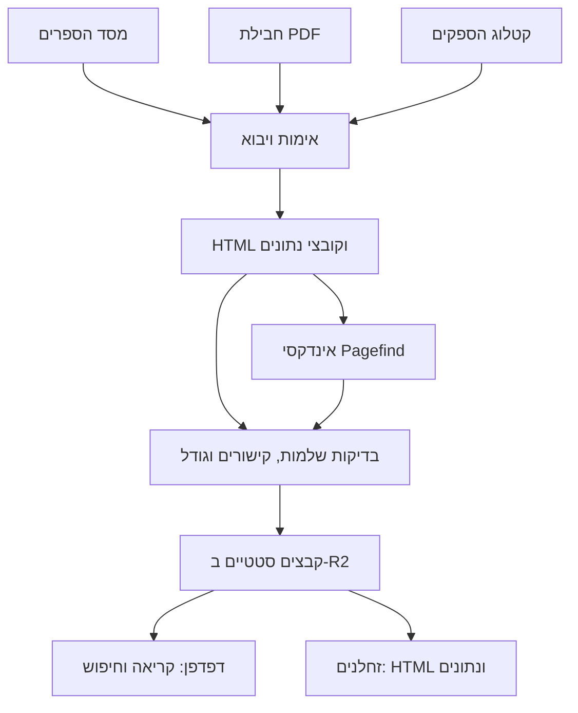

# מבנה המערכת

## עיקרון העבודה

האתר נבנה מראש מתוך ההפצה הרשמית של אוצריא. המשתמש והזחלן מקבלים אותו HTML מלא, עם קישורים רגילים בין קטגוריות, ספרים ומקטעי קריאה. JavaScript משפר חיפוש ואפשרויות קריאה; הוא אינו תנאי לקבלת הטקסט.

אין שירות חיפוש בצד שרת, ואין שליפת ספר שלם לתוך הדפדפן כדי להציג פסקה אחת. מקור האמת אינו רשימת ספרים ידנית ב-README.

## מקור הנתונים ועדכונים

פרופיל `full` משתמש בהפצה הרשמית של [Otzaria/SeforimLibrary](https://github.com/Otzaria/SeforimLibrary), המשמשת את תשתית העדכון של אוצריא ומרכזת את טקסטי המקורות. זו דרך לשמור על התאמה להרכב ולמבנה שהפרויקט עצמו מפיץ, במקום לבצע יבוא עצמאי חלקי מכל מאגר צדדי.

היבוא שומר גרסת מקור, שייכות לספר, מחבר, קטגוריות, כותרות ומידע ייחוס. כל טקסטי ההפצה נכללים בפרופיל המלא; שדות רישיון וייחוס מתארים את המקור ואינם מסנן שמצמצם את היקף הספרייה. פרופיל `starter` נועד לפיתוח ולבדיקות מהירות בלבד.

מהדורות חלופיות בעלות תוכן נבנות כספרים בעלי כתובות נפרדות וקישורים הדדיים למהדורה הראשית. משמעות השורות החסרות והשורות המשותפות תואמת את הקורא של אוצריא. הקשרים בין הספרים מיוצאים כ-JSON עם מזהי השורות המקוריים. חבילת צילומי הבבלי מיובאת ממקור ההתקנה של היישום ומוגשת כקובצי PDF סטטיים. [UPSTREAM.md](UPSTREAM.md) מתעד את קוד היישום שעליו מבוססים כללי הבחירה והפענוח.

הקטלוג החיצוני שהמתקין מוריד בדרך כלל מיובא בנפרד. כל רשומות הספקים ושדותיהן נשמרים, יחד עם כל המיפויים לספרי אוצריא. עמודי HTML ו־JSON מחולקים לטווחים קבועים של 200 מזהי ספק, כך שהוספת רשומה אינה מזיזה כתובות קיימות. מיפוי לספר חסר נשמר בנתונים בלי להפיק קישור מקומי שבור. טקסטי הספקים עצמם אינם נמצאים במסד הקטלוג; הקישור לספק תואם לקישור שהיישום פותח.

הקטלוג המקומי נמצא ב-`.cache/library/catalog.json`, וטקסטי הספרים בקבצים לצדו. קובצי המקור והנתונים הנגזרים אינם נשמרים בהיסטוריית Git. הקוד, תצורת היבוא ודוגמאות הפיתוח כן נשמרים בריפו. `SOURCE_CATALOG` מאפשר לבחור קטלוג מסוים במפורש.

הפצה רשמית חדשה עשויה להגיע אחרי שינוי במאגר טקסטים. תהליך העדכון עוקב אחרי ההפצה המפורסמת; הוא אינו מציג commit גולמי שלא נכנס אליה כאילו כבר נכלל. שינוי סכמת ההפצה צריך לעבור התאמה ובדיקות, ולא להתפרש בשקט לפי סכמה ישנה.

### זהות ספרים

מזהי הספרים מבוססים על מזהים יציבים של המקור. תשתית [IdAllocator של המקור](https://github.com/Otzaria/SeforimLibrary/blob/otzaria/DELTA_UPDATE_WORKFLOW.md) שומרת הקצאה בין הפצות. שינוי בתוכן אינו יוצר מזהה ספר חדש. נדרשת הגירת כתובות מפורשת אם בעתיד משתנה קו גרסאות שמאפס מזהים.

יש להפריד בין מזהה כתובת למזהה תקינות: checksum של תוכן משמש לזיהוי שינויים ולא לשם הנתיב הציבורי. כותרות ומראי מקום נשמרים כפי שמתקבלים מהספרייה, והטקסט מקודד בצורה בטוחה לפני שילוב ב-HTML.

## מבנה כתובות וממשקי נתונים

| כתובת | תפקיד |
| --- | --- |
| `/index.html` | שער הספרייה |
| `/catalog/index.html` | קטלוג הספרים הראשון, עם קישורי המשך |
| `/catalog/page-N.html` | עמודי קטלוג נוספים |
| `/categories/<id>.html` | עיון בקטגוריה, עם חלוקה לעמודים לפי הצורך |
| `/books/<id>/index.html` | פרטי הספר ותוכן העניינים |
| `/books/<id>/<section>.html` | טקסט מלא של יחידת קריאה |
| `/books/<id>/book.json` | מטאדאטה וקישורי יחידות הספר |
| `/books/<id>/text.txt` | טקסט הספר להורדה |
| `/books/<id>/links.json` | קשרים למקורות אחרים עם מזהי ספרים ושורות מקוריים |
| `/connection-types.json` | מילון סוגי הקשרים של ההפצה |
| `/talmud-pdfs.html` | קטלוג צילומי התלמוד, כולל קבצים ללא התאמת טקסט |
| `/pdfs/<id>.pdf` | קובץ מצולם המצורף להפצה |
| `/pdfs/catalog.json` | קטלוג מכונה של הקבצים המצולמים ומקורם |
| `/media/<sha256>.png` או `.jpg` | איורים שחולצו מתוכן הספרים המקורי |
| `/media/catalog.json` | פרטי האיורים ובדיקות התקינות, כולל חוסרים שכבר קיימים במקור |
| `/external/index.html` | בחירת קטלוג חיצוני |
| `/external/<provider>/index.html` | קישורים לכל עמודי הספק |
| `/external/<provider>/<bucket>.html#<record-id>` | רשומת ספר עם עוגן קבוע בעמוד מטאדאטה |
| `/external/<provider>/<bucket>.json` | הרשומות המקבילות עם כל שדות המקור וקישור `next` |
| `/external/catalog.json` | מניפסט הספקים, עמודי הרשומות וקובצי המיפויים |
| `/external/search.html` | חיפוש בשמות, במחברים ובפרטי המהדורות |
| `/external/search-manifest.json` | אינדקסי המטאדאטה הנפרדים מחיפוש טקסט הספרים |
| `/catalog.json` | קטלוג ראשי וקישורים לנתונים |
| `/catalog/page-N.json` | נתוני ספרים במנות עם קישור `next` |
| `/sources.json` | מקור, גרסה והיקף היבוא |
| `/search-manifest.json` | תיאור אינדקסי החיפוש שהבנייה הפיקה |
| `/build-manifest.json` | נתוני הבנייה וספירות התוכן |
| `/sitemap.xml` | אינדקס מפות האתר |
| `/llms.txt` | נקודת כניסה קצרה לסוכנים ולמפתחים |

הנתיבים כוללים `.html` במפורש כדי שניתן יהיה להגיש אותם גם מאחסון אובייקטים שאינו מבצע directory-index. `BASE_PATH` נוסף לכל הקישורים, הנכסים, מפות האתר והכתובות הקנוניות. הבדיקות מריצות בנייה גם בשורש וגם בתת-נתיב.

קריאה של JSON אינה API דינמי. אין הרשאות API, מגבלת שאילתות של שרת חיפוש או ניהול session. קליינט יכול להוריד קטלוג, לעבור לעמודי הנתונים הבאים ולפתוח את הטקסט של הספר הרצוי. ציטוט צריך לכלול שם ספר, יחידה וקישור קנוני, ובמידת הצורך מזהה פסקה.

## חלוקה ליחידות ו-SEO

ספרים ארוכים נחלקים לפי כותרות וגבולות קריאה, עם מגבלת גודל. כל יחידה מקבלת כותרת דף, תיאור, canonical לעצמה, breadcrumbs ונתוני Book/Chapter המתאימים לתוכן הגלוי. כל היחידות נגישות בקישורים רגילים, ולא רק מתוצאות חיפוש JavaScript.

Googlebot מתעד כיום מגבלה של 2 MB לא דחוסים למסמך HTML. לכן הבנייה מגבילה דף HTML ל-1,000,000 בתים ומחלקת תוכן מוקדם יותר. מגבלה זו נועדה למנוע אובדן טקסט בסריקה ולשמור על חוויית קריאה; אין משמעות של דירוג למספר בתים מסוים. [תיעוד Googlebot](https://developers.google.com/search/docs/crawling-indexing/googlebot).

מפות האתר מחולקות בהתאם למגבלות 50,000 כתובות או 50 MB וכוללות כתובות מלאות וקנוניות. יחידות קריאה אינן מקבלות כולן canonical לדף הראשון של הספר. חיפוש פנימי אינו אמור לייצר אינסוף עמודים לאינדוקס. [תיעוד מפות האתר](https://developers.google.com/search/docs/crawling-indexing/sitemaps/build-sitemap).

`llms.txt` ונתוני JSON מספקים ממשק נוח לסוכנים. הם אינם מחליפים HTML, אינם מבטיחים אינדוקס ואינם מספקים יתרון מיוחד בדירוג Google. [הנחיות Google לחיפוש מבוסס AI](https://developers.google.com/search/docs/fundamentals/ai-optimization-guide).

## חיפוש סטטי בעברית

Pagefind מאנדקס את הטקסט שנבנה ל-HTML ומייצר מקטעי אינדקס סטטיים. הדפדפן מבקש את המקטעים הנחוצים לשאילתה, ולא את כל מאגר הספרים. תוכן ניווט חוזר אינו חלק מגוף הטקסט המיועד לאינדוקס.

יש תמיכה בממשק עברי ובנרמול סימנים דיאקריטיים. אין ב-Pagefind מנגנון stemming עברי, ולכן לא מובטחת התאמה בין כל ההטיות או כל צורות הכתיב. נדרשות בדיקות לשאילתות עם ובלי ניקוד, רווחים, מקפים וגרשיים. [תמיכה בשפות](https://pagefind.app/docs/multilingual/), [הגדרות החיפוש](https://pagefind.app/docs/search-config/).

האינדקסים נבנים בזה אחר זה. המתכנן מגביל כל קבוצה ל־128 MiB של תוכן קלט כברירת מחדל. `SEARCH_SHARD_BYTES` משנה את התקציב; `SEARCH_SHARDS` הוא מספר קבוצות התחלתי, והמתכנן מוסיף קבוצות ככל שנדרש כדי לעמוד בתקציב. כל עמוד מופיע בקבוצה אחת בדיוק, ללא דגימה או השמטה.

ספר הבסיס ומהדורותיו נשמרים באותה קבוצה כאשר המשפחה כולה נכנסת בתקציב. משפחה גדולה מהתקציב מפוצלת בגבולות עמודי הקריאה. הגבלת הקלט מצמצמת עומס בבנייה, אך אינה התחייבות לשיא זיכרון: Pagefind מחזיק גם עותקי תוכן ומבני אינדקס בזיכרון. במכונה מוגבלת אפשר להקטין את התקציב ולמדוד מחדש.

חיפוש המשלב כמה אינדקסים סטטיים יכול לצרוך יותר תעבורה וזמן ככל שמספרם גדל; יש למדוד זאת מול ההפצה המלאה. [חיפוש בכמה אינדקסים](https://pagefind.app/docs/multisite/).

חיפוש הקטלוג החיצוני משתמש ברשומות מותאמות של Pagefind ובקבוצות של עד 5,000 רשומות או 16 MiB קלט. קטעי התוצאות נאספים לקבצים משותפים כדי להפחית את מספר אובייקטי האחסון. האינדקס נטען רק כאשר מבוצע חיפוש בקטלוג הזה. טוקנים שמורכבים מסימני פיסוק בלבד מוסרים מתוכן האינדקס כדי למנוע פערי מיקום בביטויים כמו `"מקראות גדולות - בראשית"`; כותרת התצוגה וכל מטאדאטת המקור נשמרות ללא שינוי. בנייה חוזרת מסמנת את האינדקס `pending`, מנקה רק את קובצי החיפוש החיצוני, ומסמנת `ready` לאחר השלמה מלאה.

### המשך בניית חיפוש שנקטעה

אפשר להמשיך את אינדקס הליבה על אותם קובצי HTML שכבר נוצרו, עם `SEARCH_RESUME=1 node scripts/index-search.mjs` ועם אותן הגדרות `OUTPUT_DIR`, `BASE_PATH`, `SEARCH_INPUT` ותקציב החלוקה ששימשו בבנייה המקורית. אין להריץ קודם בניית HTML חדשה: זמן הבנייה משתנה, ולכן האינדקסים הקודמים לא ישמשו אותה.

קבוצת חיפוש נשמרת להמשך רק לאחר שנכתבו כל קובצי האינדקס ומספר עמודי העברית תואם בדיוק לרשימת הקלט. לפני שימוש חוזר נבדקים זהות הבנייה, נתיב הפלט, נתיב האתר, קוד יצירת האינדקס ורשימת העמודים, ולאחר מכן חותמת קובץ הכניסה ורשימת כל שמות הקבצים וגדליהם. מחיקה, שינוי שם או קיטוע של קובץ מחייבים בנייה מחדש של הקבוצה. הבדיקה אינה מחשבת חותמת מלאה לכל מקטע אינדקס, ולכן אין להסתמך עליה לזיהוי שינוי תוכן ששמר על גודל הקובץ. אין לערוך את קובצי ה-HTML בין המשכים של אותה בנייה.

`SEARCH_BATCH_LIMIT=3 SEARCH_RESUME=1 node scripts/index-search.mjs` מגביל הרצה לשלוש קבוצות חדשות ומאפשר אבחון במנות. אם נשארו קבוצות, התהליך יוצא בקוד `2` ומשאיר את החיפוש במצב `pending`. רק ריצה שסיימה את כל הקבוצות כותבת מניפסט חיפוש מלא ומסמנת `ready`; אין לפרסם תוצאה שנעצרה באמצע. תהליך הפריסה הרגיל אינו משתמש במגבלת המנות.

## גבולות והפעלה

- R2 הוא יעד הייצור המלא. הפלט נשאר נייד לכל שרת קבצים סטטיים בעל מספיק נפח ומספר קבצים.
- בדיקת גודל סופרת את כל קובצי הפלט, כולל חיפוש והורדות. ביעד Pages היא נכשלת כאשר המכסות נחצות; היא אינה מוחקת ספרים כדי להיכנס למכסה.
- `full` אינו נופל אוטומטית ל-`starter` אם היבוא לא הצליח.
- התקלה בזמן יבוא או בנייה אינה מפרסמת קטלוג חלקי במקום הגרסה התקינה.
- שמירת מקור ורישיון היא ייחוס טכני של מה שהופץ, ואינה המצאה של רישיון חדש לטקסט.
- פרופיל הטקסט אינו OCR לסריקות PDF שאינן קיימות כטקסט במקור. היקף היבוא הנוכחי מפורסם במניפסט.
- דף נגיש טכנית אינו מבטיח שיופיע במנוע חיפוש. החלטות סריקה, קנוניזציה ודירוג נשארות אצל המנוע.

הגדרות הפריסה, מכסות, שמירת מטמון והפעלת העדכון היומי מתועדות ב-[DEPLOYMENT.md](DEPLOYMENT.md).
