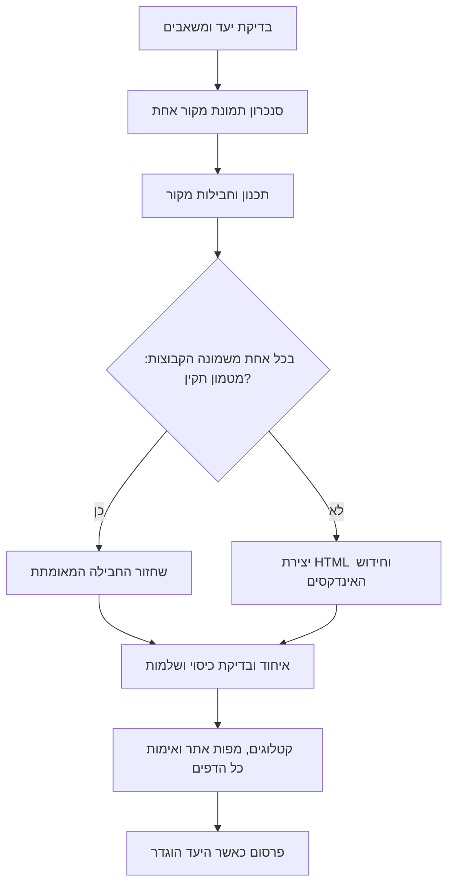

# מחקר ביצועים והחלטות מימוש

עודכן: 22 בנובמבר 2026. המסקנות מבוססות על יומן הבנייה המקורי, קריאת הקוד, תיעוד ראשוני והשוואות שניתן להריץ מחדש. מספרים של אוסף הפיתוח אינם תחזית לזמן הספרייה המלאה.

## הדרישות המחייבות

- האתר והחיפוש סטטיים לחלוטין. אין שרת חיפוש, API בתשלום או מסד מקוון.
- הבנייה משתמשת במכונות Linux סטנדרטיות וחינמיות של GitHub במאגר הציבורי.
- להשקה נדרשים חיפוש טקסט, ביטוי מדויק וסינון. ניתוח שורשים וחיפוש סמנטי אינם דרישה.
- כל דפי הקריאה נשמרים כ־HTML מלא ונפרד. כתובות, מזהי מקורות, עוגנים, מהדורות, הערות, ייחוס ויכולת קריאה ללא JavaScript נשמרים.

## 1. אבחון ההרצה המקורית

[Run 44972240960](https://github.com/NHLOCAL/otzaria-web/actions/runs/44972240960), ב־commit `370048cc64098a9aa09ab2b972207f133791d634`, הסתיים בהצלחה. [עבודת הבנייה 137054363857](https://github.com/NHLOCAL/otzaria-web/actions/runs/44972240960/job/137054363857) נמשכה 1:57:06. הפרסום דולג משום שהיעד ופרטי R2 לא הוגדרו.

| שלב | זמן שנצפה ביומן |
| --- | ---: |
| סנכרון מקורות | 4:34 |
| יצירת HTML ויצוא | 19:57 |
| אינדוקס הטקסט הראשי | 78:28.8 |
| אינדוקס קטלוגים חיצוניים | 1:19 |
| חישוב גודל | כ־0:38 |
| בדיקת HTML וקישורים | 10:44.9 |
| פרסום | דולג |

האינדוקס הראשי הוא כ־67% מזמן העבודה. הסנכרון אינו צוואר הבקבוק העיקרי בהרצה זו. הגדלת מספר ההורדות המקבילות או החלפת יבואן Python לא היו מטפלות ברוב הזמן.

ביומן `df` הופיעו **105GB פנויים** אחרי ניקוי תוכנות מיותרות. הטענה הקודמת במסמך זה, שלפיה תוצר של כ־26GB חרג בהכרח מדיסק של 14GB וגרם לתקיעה, לא נתמכה ביומן והיא תוקנה. טבלת GitHub מתעדת משאבים סטנדרטיים, אך יש למדוד את המקום הפנוי במכונה שהוקצתה בפועל. המימוש החדש בודק משאבים לפני השלבים הכבדים ומפיק אבחון מפורש.

היקף הייחוס ההיסטורי: 9,799 יצואי ספרים, 378,696 דפי קריאה, 390,614 דפי HTML, ‏870,509 קבצים וכ־25.96GB. אלו נתוני הבנייה הקודמת ב־[דוח האימות](VALIDATION.md), ולא ספירה חדשה של המימוש המשופר.

## 2. מדוע נשארים עם Pagefind ו־Node

Pagefind כבר מפעיל **מנוע אינדוקס מקומי ב־Rust** דרך ממשק Node. אין הצדקה לכתוב מחדש את כל ה־renderer או את היבואן ב־Rust לפני שמטפלים בתכנון העבודה ובהעברת הנתונים למנוע הקיים. Python משתמש גם הוא בספריית zstd מקומית; רוב זמן הבנייה שנמדד אינו בפענוח הארכיון.

השוואה ל־[Hugo](https://gohugo.io/troubleshooting/performance/) ול־[בנייה במקטעים ב־Hugo](https://gohugo.io/configuration/segments/) מראה את הדפוסים השימושיים: מדידת שלבים ותבניות, עיבוד מקטעים עצמאיים ושימוש חוזר לפי תלות מפורשת. Zola מספק מחולל ב־Rust, אך מעבר אליו יחייב העתקת כללי סימון המקור, פרקי הקריאה, המהדורות והעוגנים. הוא גם אינו מחליף את עבודת Pagefind. אימצנו את שיטות העבודה בלי להוסיף מחולל חדש, שפת תבניות חדשה או שרשרת Rust נוספת לתחזוקה.

ההחלטה היא להשאיר את היבואן ואת המחולל, לשמור את הבדיקות הקיימות, ולהעביר רק את העבודה העצמאית למטריצה. אם לאחר המדידות יישאר מוקד CPU משמעותי בתוך parser הטקסט, אפשר לשקול מודול מקומי קטן עם בדיקות שקילות. אין במימוש הבטחה ש־Rust לבדו יקצר את הבנייה פי מספר מסוים.

## 3. הבנייה שהוטמעה

### חלוקה לפי תחום ומשפחת ספרים

תחום קטן שייך לעבודה אחת. רק תחומים גדולים מתחלקים לפי hash של משפחת הספר. המהדורה הראשית ומהדורותיה נשארות יחד. מספר הקבוצות לכל תחום נבחר במדרגות של חזקות שתיים, לפי נפח הטקסט. כך לא נוצרים שמונה אינדקסים זעירים לכל תחום קטן. שינוי משמעותי בגודל תחום עשוי לשנות את חלוקתו; זו פשרה גלויה בין יציבות, איזון העבודה ועלות הדפדפן.

כל עבודה מורידה רק את ארכיון המקור שלה. הקטלוג המלא נכלל כמטא־דאטה לצורך קישורים בין מהדורות, אך טקסטי הספרים האחרים, ה־PDF והקטלוג החיצוני המלא אינם משוכפלים לכל עבודה. המקורות המשותפים נשמרים בחבילה גלובלית נפרדת.

### איחוד ללא אובדן תוכן

כל חלק מסומן `partial: true` ואינו מתאים לפרסום. כל קובץ ספר מקבל SHA-256, וכל דף חיפוש מקבל hash של התוכן שאונדקס. שלב האיחוד בודק:

- שכל חלק צפוי הגיע, עם טביעת הקלט והתצורה הנכונה.
- שכל ספר וכל דף נמצאים פעם אחת בדיוק.
- שכל קובץ ספר תואם לגודל ול־SHA-256 שנרשמו, כולל פגיעה שאינה משנה אורך.
- שכל אינדקס מכיל את מספר הדפים הנכון ואת כל קובצי Pagefind ללא שינוי.
- שכיסוי האינדקס תואם בדיוק לרשימת הדפים ולתוכנם בבנייה המאוחדת.

לא מתפרסם manifest מוכן אם חסר חלק. בדיקת הפרסום עצמה דוחה גם `partial`, בנוסף לבדיקות ה־workflow. הקטלוגים, מפות האתר ודפי הכניסה נוצרים לאחר האיחוד.

### חיסכון בתוך ה־renderer

- שורות שאין בהן `<` או `&` אינן דורשות DOM של HTML. הן עוברות מסלול טקסט ישיר עם escaping זהה. תגיות, ישויות ומקרים מורכבים ממשיכים דרך parse5.
- תיקיות מוכנות נשמרות בזיכרון, במקום `mkdir` חוזר לכל דף.
- `book.json` נכתב כ־JSON קומפקטי, ללא שינוי בסכמה או בתוכן.
- סרגל פעולות הקריאה, שממילא הוסתר ללא JavaScript, נוצר מעותק משותף אחד בסקריפט. כל דף שומר מכולה ריקה קטנה. הקוד שומר על הכפתורים הקיימים בדף ישן, והכתובת `app.js?v=2` מונעת טעינת סקריפט ישן עבור דף חדש. הטקסט, הקישורים, העוגנים והמטא־דאטה נשארים ב־HTML.
- גוף החיפוש מופק מאותה פונקציית `readingArticle` שמייצרת את מאמר הקריאה. הוא שומר כותרות, מסננים, מטא־דאטה, הערות ועוגנים, ומשמיט תפריטים, כלי קריאה, footer ו־JSON-LD שאינם משתתפים בחיפוש.
- קלטי החיפוש מאוגדים בקובץ JSON אחד לכל ספר. לא נוצר עותק דיסק קטן נוסף לכל אחד ממאות אלפי הדפים.

### אימות מלא במקביל

בדיקת HTML עוברת פעם אחת על ה־DOM של כל מסמך. עוגנים מקומיים נבדקים באמצעות `Set`, ורשימת קבצי היעד נאספת פעם אחת. ארבעה workers בודקים מנות קטנות של מסמכים; אין דילוג על דפים ואין דגימה במקום אימות מלא. `VERIFY_CONCURRENCY=1` מאפשר הרצה שמרנית או השוואה. דוח האימות שומר את מספר הדפים, זמן העבודה והשגיאות.

## 4. מטמון והתאוששות

יש שתי שכבות משלימות:

| שכבה | מתי ניתן להשתמש בה | גבול לכל עבודה |
| --- | --- | ---: |
| חבילת תוצאה דחוסה של חלק | אותה קבוצת קלטים, מטא־דאטה, קוד ותצורה בדיוק | חלק יחסי מתוך תקציב כולל של 9,000,000,000 בתים |
| אינדקס Pagefind של מקטע | אותם דפים ותוכן, URL, גרסת מנוע ואפשרויות אינדוקס | עד 512MiB, ולא יותר מתקציב החלק |

פגיעה במטמון החלק מדלגת על רינדור ואינדוקס שלו. אם חבילת התוצאה נכנסת לתקציב, נשמרת רק היא במטמון GitHub. אם אינה נכנסת, נשמר במקום זאת מטמון מקטעי חיפוש מוגבל, שיכול למחזר מקטעים שלא השתנו בבנייה הבאה. שתי השכבות אינן מועלות במקביל עבור אותה עבודה. הריצה אינה תלויה בזמינות המטמון: בהיעדרו נבנים התוצרים מחדש. מקטע חיפוש פגום אינו מתקבל ומשוחזר בבנייה. פגיעה בחבילת תוצאה מלאה נעצרת בבדיקות השלמות של האיחוד; היא אינה מתפרסמת ואינה מתקנת את עצמה בתוך אותה ריצה. בפרט, אין הבטחה שמטמון מקטעים נפרד יהיה זמין אחרי שנשמרה חבילת תוצאה שלמה.

מפתחות האינדקס אינם כוללים `builtAt` או נתיב מוחלט של runner. הם כוללים hashes של התוכן בפועל, ולא רק את אורכו. קבלות השלמות כוללות hashes של קובצי האינדקס, ולכן קובץ שנפגם באותו מספר בתים אינו מתקבל כמטמון תקין. אפשר לחדש עבודה שנקטעה באמצעות `SEARCH_RESUME=1`.

התקציב הכולל למחזור פעיל הוא 9GB עשרוניים, המחולקים לפי גודלי ארכיוני המקור הדחוסים שנמדדו בהכנה. כך נשאר מרווח של לפחות 1GB עשרוני לתלויות בתוך מכסת GitHub של 10GB, בלי להגדיל את המכסה בתשלום. בתיעוד החיוב GitHub מגדיר GB כאוסף של 2^30 בתים; התקציב שלנו מחושב במפורש בבתים עשרוניים והוא שמרני יותר. דוח החלוקה נשמר בנפרד; תוכנית המקור שבתוך הארכיונים נשארת בלתי משתנה. אין מטמון של ארכיון המקור הגדול. GitHub מנהל פינוי של גרסאות ישנות; אין הבטחה שכל מקטע יישאר במטמון בין ריצות.

הבחירה נעשתה בעקבות ההרצה המלאה: שמונת ארכיוני התוצאה היו יחד כ־8.71GB, וכל אחד מהם חרג מהמגבלה הראשונית של 512MiB. מגבלה אחידה של 1GiB הייתה שומרת רק ארבע מחיצות. החלוקה לפי המקור הדחוס מתאימה לכל שמונת התוצרים שנמדדו, בתוך תקציב 9GB. המרווח הצר ביותר במדידה הוא כ־3.87MiB; מקור עתידי שיגדל בצורה אחרת עשוי לעבור למסלול מטמון המקטעים. זו התאמה מבוססת מדידה, ולא הבטחה שכל הפצה עתידית תיכנס למטמון התוצאה.

**מגבלה חשובה:** טביעת חלק כוללת מטא־דאטה אמיתי של המקור. גרסת מקור חדשה יכולה לעדכן כתובת release או תאריך בכל הספרים, גם אם טקסטים רבים זהים. במקרה כזה מטמון תוצרי HTML ייפסל בהתאם, ואינדקסי חיפוש שתוכנם זהה עדיין יכולים לשמש שוב. לא נטען שבכל release חדש רק ספרים עם שינוי מילים נבנים מחדש.

לכל תהליך אינדוקס יש מגבלת זמן וברירת מחדל שמרנית של זיכרון. ההרצה המלאה הראשונה הפעילה אינדקס אחד בכל עבודה ומדדה שיא RSS של עד כ־5.12GiB. התצורה הסופית מבקשת עד שני אינדקסים בעבודה, בכפוף לשער CPU וזיכרון קיים שמקצה אומדן של 6GiB לכל אינדקס בגודל 128MiB ועוד רזרבה. אין עקיפה של השער במכונה חלשה יותר. מדידת RSS כוללת את התהליכים הצאצאים, אך היא דגומה ואינה תקרת זיכרון קשיחה. ברירת המחדל מתחשבת גם במגבלת cgroup ולא רק בזיכרון המארח.

גם ניקוי SDKs במכונת הבנייה נעשה כעת רק כאשר בדיקת המקום הראשונית נכשלת. בשתי מכונות אימות ללא ניקוי נמדדו כ־85 וכ־88GiB פנויים, מעל דרישות הבנייה; מחיקה גורפת בכל עבודה הוסיפה הכנה שלא הייתה נחוצה במכונות האלה. בדיקת משאבים סופית נשמרת בכל מקרה.

## 5. בחירת מנוע חיפוש סטטי

| מנוע או גישה | יתרון רלוונטי | מחיר שילוב | החלטה |
| --- | --- | --- | --- |
| Pagefind | Rust לבנייה, WASM בדפדפן, ביטויים, מסננים, מקטעים לפי דרישה | דורש תכנון מקטעים ובדיקת דירוג בעברית | נשאר המנוע הראשי |
| MiniSearch | קטן ונוח לקטלוג שמות בזיכרון | אינו מספק אינדקס מיקומים לביטויים כפי שנדרש כאן; טעינת קורפוס גדול בעייתית | אינו תחליף לטקסט המלא |
| FlexSearch | workers, הקשר ואפשרויות התמדה בדפדפן | דורש תכנון הפצה, טעינה, גרסאות ודירוג חדש; אינדקס הקשר מוסיף זיכרון | לא הוחלף בלי הוכחת יתרון |
| Orama JS | מנוע טקסט זמין בדפדפן | אין במדידות שנאספו הוכחה להתאמה טובה יותר לקורפוס זה | חלופה לבדיקה עתידית ממוקדת |
| Stork | Rust ו־WASM עם ממשק סטטי | המתחזק הודיע שסיים את עבודתו הפעילה בפרויקט | אינו תלות אסטרטגית חדשה |
| SQLite FTS5 עם HTTP Range | תמיכה במיקומים ובביטויים, אחסון קומפקטי | שכבת מערכת קבצים מרוחקת, תכנון דפים וקריאות רשת | מעניין למחקר, לא החלפה מוכחת |
| Tantivy של הדסקטופ | מנוע עשיר וכללי טקסט של אוצריא | קבצים מקומיים, סכמות, fork ותלות ב־SQLite; אין חבילת דפדפן מוכנה | לא מיובא לווב |

הדגמות [MDN](https://mdn.pagefind.app/) ו־[Godot](https://godot.pagefind.app/) של Pagefind מראות חיפוש מלא בצד הלקוח. הן דוגמה לארכיטקטורה, ולא benchmark בגודל הספרייה שלנו.

Pagefind תומך בחיפוש עברי בלי לטעון שכללי stemming עבריים קיימים בו. חיפוש רגיל דורש כעת את **כל המילים השלמות**, בכל סדר. הביטוי המדויק בממשק הוא שאילתה שלמה בתוך מירכאות כפולות, למשל `"בראשית ברא"`, ומחייב סדר ומיקומים רצופים לפי מנוע האינדוקס. לא מוצג מצג של תחביר Boolean מורכב או שילוב שרירותי של תתי־ביטויים. בדיקות מקור בוחנות ניקוד, ראשי תיבות, סדר מילים, ביטוי רצוף, תחום ותוצאות ממקורות צפויים.

בדיקת קוד המקור של Pagefind 1.6.0 וניסויים באינדקסים אמיתיים חשפו שחיפושו הרגיל מרחיב תחיליות, ואף עשוי להשתמש בתחילית קצרה יותר כאשר אין הרחבה מתאימה. קבוצת התוצאות יכולה להשתנות עם חלוקת האינדקס ועם מקטעי מילים שכבר נטענו. באותו אוסף בן ארבעה מסמכים, פיצול לשני אינדקסים שינה שתי תוצאות לשלוש והוסיף מסמך שבו רק `ברא`. בניסוי נוסף עם סף המיקומים המקורי של המנוע, מספר התוצאות השתנה מאחת לארבע בעקבות החלוקה; חימום מקטע תחילית שינה אחת לשתיים בלי לשנות את האינדקס. התנהגות זו אינה מדיניות החיפוש הרצויה להשקה.

לכן הלקוח מבצע בתוך כל אינדקס חיפושים מקוריים של מילה בודדת במירכאות, חותך את מזהי התוצאות, ואז משתמש בשאילתה המקורית לקבלת דירוג ותמציות. בדיקת שלמות מונעת השמטה שקטה אם שאילתת הדירוג אינה מכילה את כל המועמדים המדויקים. ביטוי שלם במירכאות מועבר למנוע המיקומים הקיים. אין fork של המנוע או שימוש בשדות פנימיים. נרמול משותף מסיר ניקוד וגרשיים פנימיים, מזהה את זוג המירכאות החיצוני לפני הסרתם, ושומר מקף ומקף עברי בתוך ביטוי, כדי לא לשנות מיקומי מילים מורכבות.

### טעינה וסינון בדפדפן

מניפסטים מציינים את התחומים או הספקים של כל אינדקס. הבחירה נעשית לפני טעינת נתוני האינדקס. תוצאות מקבלות את דירוג Pagefind, ותמציות נטענות רק עבור תוצאות שמוצגות בפועל. שאילתה שהתיישנה בעקבות הקלדה או החלפת תחום אינה רשאית להחליף תוצאות חדשות.

המימוש הסופי מפעיל Web Worker אחד בבעלות האתר לכל תחום פעיל, וטוען בתוכו פעם אחת את מודול Pagefind. כל מקטע מקבל מופע דרך `createInstance` ו־`noWorker` המתועדים. האתחול הראשון מסתיים לפני אתחול המופעים הנוספים, וכולם משתמשים באותו backend של WASM. מטמון תגובות פנימי ממחזר את קובץ ה־WASM המוצלח לאותה שפה, כך שבפועל מתבצעת הורדת WASM אחת. העבודה מוגבלת לארבע פעולות אינדקס ולשמונה הורדות פעילות, כולל זמן הורדת הגוף ולא רק קבלת הכותרות, בלי לשנות את `fetch` של העמוד.

ההפרדה בין המופעים נחוצה גם לתקינות: מזהה Pagefind הקצר ייחודי בתוך אינדקס, אך אינו ייחודי בין אינדקסים. בדיקת רגרסיה כוללת שני מסמכים אמיתיים שהמנוע נתן להם אותו מזהה `he_fb3efe5`, אחד מכיל רק `בראשית` והשני רק `ברא`. חיתוך המילים נעשה בתוך האינדקס, ורק אחריו נוסף נתיב המקטע למזהה וממוזגות התוצאות. כך אי אפשר ליצור תוצאה משותפת משני מסמכים שונים. הממשק מציג את מספר התוצאות בפועל; ספירות מסננים מקורבות משאילתת התחיליות אינן מוצגות כאילו הן ספירות החיתוך.

החלפת תחום או ביטול עבודה פעילה סוגרים את ה־worker הישן. תוצאות עצלות קשורות לדור השאילתה, ולכן תמצית ישנה אינה יכולה לשמש תוצאה חדשה. טיפול בכשלי HTTP, רשת או פענוח בתוך ה־worker מונע תוצאות חלקיות ש־Pagefind 1.6 עלול להחזיר אחרי שהוא לוכד שגיאה פנימית. בדיקות הרגרסיה כוללות גם קובץ פגום שחזר עם HTTP 200, ולא רק שגיאת 503.

בהשוואה מבוקרת של ה־worker הממזג לגרסה הסופית על אותם 1,545 דפים וחמישה אינדקסים, חיפוש כללי לפני תמציות הוריד בשניהם 263,617 בתים ב־17 בקשות. ביטוי מדויק, כולל תמציותיו, הוריד בשניהם 284,494 בתים ב־22 בקשות והחזיר אותן חמש תוצאות. חיפוש בתחום תנ״ך לפני תמציות הוריד בשניהם 129,752 בתים בשש בקשות. מספר התוצאות הרגילות השתנה בכוונה מ־302 התאמות תחילית ל־12 התאמות של כל המילים, ובתחום תנ״ך מ־251 ל־11. אלו גופי תגובה ב־worker עם Pagefind המקורי וקבצים מקומיים, בלי העברת המניפסט וייבוא המודולים; אין להסיק מהם זמן רשת, ביצועי טלפון או נתוני הספרייה כולה. מדידת הלקוח הקודם, שכללה מניפסט ו־15 תמציות, נשמרה בנפרד בקובץ הראיות ואינה אותה סדרת מדידה.

## 6. פורמטים, דחיסה ואחסון

| שימוש | פורמט שנבחר | הסיבה |
| --- | --- | --- |
| דפי קריאה וגילוי SEO | HTML עצמאי ב־UTF-8 | כל כתובת נשמרת ונקראת ללא הרצת קוד |
| קטלוגים ופרטי ספר | JSON מדופדף או לפי ספר, קומפקטי | כלי עבודה פשוטים, סכמה גלויה וטעינה מוגבלת |
| הורדת הטקסט המלא | TXT לפי ספר | נשמר הממשק הקיים למשתמשים ולכלי ציטוט |
| קלט האינדוקס | JSON פנימי לפי ספר, ובו HTML חיפוש מצומצם | פחות פתיחות קבצים ופחות parsing בלי שינוי סמנטיקה |
| מעבר בין עבודות | `tar.zst` ברמת דחיסה 3 | חיבור קבצים קטנים לארכיון אחד ודחיסה מהירה, ללא שינוי בתוצר המוגש |
| מקטעי Pagefind | הפורמט הדחוס המקורי של Pagefind | אין שכבת דחיסה או loader חלופיים לתחזוקה |
| PDF ותמונות | הקבצים המקוריים המאומתים | לא דוחסים מחדש מדיה שכבר דחוסה |

לא הוחלפו דפי HTML במסד בינארי, ולא הוסרו קובצי TXT או מהדורות כדי להציג תוצאה קטנה יותר. לא נוספו לכל אובייקט עותקי `.gz` ו־`.br`: הדבר מכפיל את מספר האובייקטים ודורש טיפול נכון ב־Content-Encoding ובמטמון. דחיסה ברשת היא תכונת ההגשה שיש למדוד ביעד האמיתי. `_headers` אינו קובץ תצורה ש־R2 מפעיל בעצמו.

הארכיונים מועלים ל־Actions עם `compression-level: 0`, משום שהם כבר דחוסים, ונשמרים יום אחד. דוחות קטנים נשמרים יותר זמן. אחרי החילוץ הארכיון מוסר מה־runner. אי אפשר להניח שכל 26GB של `dist` מתאימים למטמון התלויות החינמי.

### חלופות לפורמט הנתונים

[CBOR, בתקן RFC 8949](https://www.rfc-editor.org/rfc/rfc8949.html), הוא פורמט בינארי שמכוון לייצוג קומפקטי ולהרחבה. מעבר אליו כאן יוסיף מקודד בבנייה ומפענח בצד הלקוח, וגם חוזה נתונים נוסף לבדיקות. לא נמדד יתרון שלו מול JSON קומפקטי עם דחיסת HTTP על הנתונים האלה. לכן הוא אינו מחליף כעת את קובצי הספר והקטלוג; אם נפח מטא־דאטה מסוים יהפוך לצוואר בקבוק, נכון להשוות את אותו payload ואת עלות המפענח לפני שינוי הסכמה.

[Parquet](https://parquet.apache.org/docs/overview/) הוא פורמט עמודתי המיועד לאחסון ולעיבוד נתונים בכמויות גדולות. הוא יכול להתאים ליצוא מחקרי נפרד, אך דפוס הגישה כאן הוא פתיחת ספר או עמוד קטלוג קטן. שילובו לא יחליף את דפי ה־HTML הנדרשים ל־SEO, ולכן כרגע הוא מוסיף פורמט וכלי קריאה בלי לפתור את צוואר הבקבוק שנמדד. זו החלטת התאמה למוצר, ולא תוצאת benchmark של Parquet.

[Zstandard](https://github.com/meta/zstd) נשאר שכבת העברה פנימית בין עבודות: פורמט דחיסה ללא אובדן עם מימוש מקומי וכלי CLI, ללא מפענח נוסף בדפדפן. רמה 3 ושני threads לארכיון הם בחירה שמרנית בזמן בנייה. לעומת זאת, דחיסת התוכן המוגש דורשת [Content-Encoding מתאים](https://developer.mozilla.org/en-US/docs/Web/HTTP/Reference/Headers/Content-Encoding) ותצורת אירוח תואמת. לא הוחלפו אובייקטי HTML בקבצים דחוסים תחת אותן כתובות בלי לוודא שהיעד מגיש כותרות נכונות.

### פשרת מספר המקטעים

Pagefind 1.6 מאפשר `maxFragments`. יעד של 64KiB לבדו הפחית מאוד את מספר הקבצים, אבל הגדיל את הורדת 15 התמציות הראשונות בערך פי שישה באוסף הבדיקה. הגדרה זו נדחתה כברירת מחדל.

ההגדרה שנבחרה משלבת את יעד הבתים עם יעד של כשני דפים בממוצע למקטע. זו אינה מגבלת גודל קשיחה לכל מקטע, ולכן יש להמשיך למדוד גם קבצים חריגים ומכשירים חלשים. `SEARCH_FRAGMENT_TARGET_BYTES=0` מחזיר מקטע נפרד לכל דף לצורך השוואה.

## 7. השוואה לאוצריא בדסקטופ

נבדקו קוד הדסקטופ ב־`cee59520a8e6d35d5350b8f51cde322d4b4b99cf` ומנוע החיפוש ב־`44e5034c51f8ca8043fbe1bb392dc544ffbd815f`. הדסקטופ מפעיל Tantivy מקומי עם גשר Flutter, סכמות ומנגנוני אחסון שאינם חלק מהדפדפן.

| יכולת בדסקטופ | שילוב בווב |
| --- | --- |
| מזהי ספר, שורה ומהדורה | נשמרים במדויק, ומשמשים כתובות ועוגנים |
| חיפוש טקסט, ביטויים ותחום | נכללים בגרסת הווב ונבדקים מול מקור |
| הצגת קטע ותנועה למקור | תמציות עצלות וקישור לדף המקורי עם הדגשה |
| מהדורות, הערות וקשרים | נשמרים בתוכן ובקובצי הנתונים; אין צורך להעתיק את כל ממשק הדסקטופ |
| הרחבות איות, regex, מרחק מילים וחיפוש עמום | מחוץ לדרישות ההשקה; לא מיובאים כמערכת נוספת |
| קרי וכתיב באותו מיקום וכללי גרשיים של tokenizer | אין הצהרת שקילות אוטומטית; נדרשות בדיקות עברית ייעודיות לפני הרחבה |
| ONNX וחיפוש סמנטי | אינם נכללים: מודלים, וקטורים ועלות הפצה אינם נחוצים למטרה |
| עדכון writer מקומי, SQLite ומסדי Tantivy | מוחלפים בפרסום סטטי מאומת של אינדקסים מוכנים |
| קוראי PDF ואינדוקס קבצים במכשיר | ה־PDF הרשמי נשמר כקובץ; אין מנגנון OCR או יבוא מרוחק נוסף |

חוב טכני נשמר נמוך באמצעות מנוע אחד, אותם מזהי מקור, אותה פונקציית HTML לקריאה ולאינדוקס, ואותן בדיקות שקילות. אין ניסיון לשכפל את מלוא מוצר הדסקטופ בדפדפן.

## 8. מדידות והשוואות שנעשו

המדידות הבאות הן מקומיות, על 60 יצואי ספרים אמיתיים ובהם 1,545 דפי קריאה. מדובר בהרצות על אותו מחשב ובאותו קלט, ולא בנתוני CDN או בטלפון.

| בדיקה | לפני | אחרי | פירוש |
| --- | ---: | ---: | --- |
| אינדוקס יחיד, HTML מלא לעומת מצומצם | 6.180 שניות | 4.840 שניות | כ־21.7% פחות זמן בהרצה זו |
| זהות תוצר האינדקס באותה השוואה | 1,643 קבצים | 1,643 קבצים זהים ב־SHA-256 | נשמרו נתוני החיפוש והעוגנים |
| מספר קובצי האינדקס, אותם 5 מקטעי תחום | 1,699 | 927 | כ־45.4% פחות עם איגוד שמרני |
| נפח אותם אינדקסים | 8,707,969 בתים | 8,375,750 בתים | כ־3.8% פחות |
| הורדת 15 תמציות באותה שאילתה | 31,092 בתים | 53,163 בתים | תוספת צפויה בעקבות האיגוד |

בדיקת שיפורי ה־parser והאינדוקס, לפני העברת סרגל הקריאה לסקריפט, השוותה 1,665 קובצי HTML ו־TXT של ספרים מול הקוד הקודם: כולם היו זהים ברמת הבתים. מבני JSON שקולים למרות הסרת הרווחים. השינוי הנפרד בסרגל, המתואר בהמשך, משנה בכוונה רק את מעטפת הכלים ואת גרסת הסקריפט. בדיקת המטריצה יוצרת ארכיונים אמיתיים, מוחקת את מקורות הספרים לפני האיחוד, בודקת חלק חסר ופגיעה באותו אורך, ומשווה את כל ה־HTML וה־TXT לבנייה רציפה של הקוד הנוכחי. היא רצה בשני base paths.

בנוסף נבדקו עשרים קובצי המקור הגדולים בספרייה המלאה: 627,046,916 בתים, כ־9.35% מנפח המקור, ו־1,038,237 tokens של parser המקור. כל תוצאות הפענוח זהות ב־SHA-256 לקוד הקודם. זמן הפענוח המצטבר ירד מ־22.646 ל־9.494 שניות, כ־58.1% פחות בהרצה המקומית. סדר המימושים הוחלף בין ספרים ונעשתה פעולת GC בין מדידות; קריאת הקובץ, חישוב hash ו־GC אינם בתוך זמן הפענוח. בניית HTML אחרת רצה באותו מחשב, ולכן זהו אבחון של ה־parser ולא הוכחה לקיצור מקביל בזמן הבנייה הכולל.

בדיקת חיפוש ייעודית בונה תשעה אינדקסים אמיתיים. היא גילתה תחרות באתחול מופעי WASM מקבילים שהשמיט תוצאה, ולכן נשמרה כבדיקת רגרסיה. בדיקות ממוקדות כוללות גם מטמון חם, שינוי תוכן, שינוי מטא־דאטה, החלפת תצורה, חידוש עבודה, קבצים פגומים ומקטעים חסרים.

### הרצה מלאה ראשונה ב־GitHub

[Run 44986830561](https://github.com/NHLOCAL/otzaria-web/actions/runs/44986830561), ב־commit `c9d08b75f82562521c2f262e55398600d030c50f`, הסתיים בהצלחה. חלפו 43:00 דקות מיצירת ההרצה עד עדכון מצב הסיום, לעומת 1:57:06 של עבודת הבנייה המקורית. זהו קיצור של כ־63.3% בזמן ההמתנה שנמדד, עם כל 9,799 יצואי הספרים, 378,696 דפי הקריאה ו־390,614 דפי HTML. זמני ה־workflow כוללים גם תורים והעברת תוצרים; הם אינם ניסוי CPU מבוקר על אותה מכונה.

| שלב בתהליך החדש | זמן שנמדד |
| --- | ---: |
| אינדוקס החלק האיטי ביותר, אחד בכל עבודה | 14:37.43 |
| סכום זמן האינדוקס בשמונה העבודות | 74:27.87 |
| איחוד HTML ובדיקת קבלות השלמות | 3:00.21 |
| איחוד ואימות כיסוי החיפוש, 106 אינדקסים | 0:44.99 |
| אינדוקס הקטלוג החיצוני | 1:00.71 |
| בדיקת גודל | 0:16.80 |
| בדיקת כל דפי ה־HTML והקישורים | 3:33.02 |

בתוצר המלא נמדדו 684,853 קבצים לעומת 870,509 בדוח הייחוס, ירידה של כ־21.3%. הנפח הכולל ירד מ־25,959,563,951 ל־25,850,150,962 בתים, כ־0.42% בלבד. עיקר החיסכון באחסון כאן הוא מספר האובייקטים; הטקסטים, כל דפי HTML, ה־PDF והתמונות נשמרו. אין טענה שהספרייה הצטמצמה משמעותית בבתים. דף HTML הגדול ביותר הוא 668,483 בתים, מתחת למגבלת המוצר המוגדרת.

הפער בין זמן האינדוקס המקביל לבין סכום זמני העבודות מדגים שהרווח העיקרי כאן הוא קיצור זמן ההמתנה באמצעות חלוקה, לצד ייעול העיבוד. אין טענה שסך צריכת ה־CPU ירד פי שמונה. ההרצה הזו הפעילה אינדקס אחד בכל עבודה ובחנה את מגבלת המטמון הישנה. היא אימתה כיסוי ותוצרים, לפני הוספת שערי שאילתות על האינדקס המלא. הפרסום עצמו דולג כמתוכנן בהרצת PR.

### הרצה מלאה שנייה: בנייה מהירה יותר, כשל בבדיקת קבלת החיפוש

[Run 44990167097](https://github.com/NHLOCAL/otzaria-web/actions/runs/44990167097), ב־commit `57bc4fc1d6997a34fad6f07fd03d605e78652672`, הסתיים במצב **failure** אחרי 28:46 דקות. כל שמונת חלקי הבנייה, האינדקסים ובדיקת כל 390,614 מסמכי ה־HTML עברו, אך שער החיפוש הכללי נכשל. אין להציג את הזמן הזה כבנייה מלאה שעברה קבלה.

בכל עבודה הופעלו שני תהליכי אינדוקס בהתאם לשער המשאבים. החלק האיטי ביותר אונדקס ב־462.052 שניות, לעומת 877.430 בהרצה הראשונה; סכום זמני האינדוקס ירד מ־4,467.865 ל־2,490.144 שניות. שיא RSS דגום מרבי היה 8,145,649,664 בתים, כ־7.59GiB. לא היו פגיעות במטמון תוצר מלא בתחילת ההרצה. שמונת הארכיונים, בנפח מצטבר 8,706,575,093 בתים, התאימו לתקציבים המחולקים ונשמרו בהצלחה. זו הוכחת שמירה בפועל, עדיין לא מדידת שחזור מלאה ממטמון חם.

הכשל היה בבדיקת ביטוי: המקור `בת עין, תצוה` כולל `בראש"ית ברא`, שה־tokenizer של Pagefind מאנדקס כשתי מילים רצופות. בדיקת מחרוזת פשוטה דחתה התאמה תקינה. הבדיקה הוחלפה בבודק עצמאי ומוגבל לעברית ולגרסת Pagefind הנעולה, שמכבד מיקומי מילים, הסרת ניקוד, רכיבי מילים מורכבות וסימני פיסוק. כל 118 התוצאות בשני אינדקסים ששוחזרו מתוך 2,123 דפים אמיתיים אומתו, לצד 26 מסמכי רגרסיה הכוללים גם סדר הפוך, מילה מפרידה ופיסוק שתופס מיקום נפרד. המקרה המקורי נמצא במיקומים 919 ו־920. נתוני מועמדי הביטוי נשמרים כעת לפני assertion, כדי שכשל עתידי יכלול מקור שניתן לבדוק.

בהרצה הכושלת, הלקוח הקודם עם חיפוש תחיליות הוריד 10,113,962 בתים ב־364 בקשות באינטראקציה הראשונה, לעומת 7,805,350 בתים ב־306 בקשות בדוח הישן עם 87 אינדקסים. זו **נסיגה מדודה של כ־29.6% בבתים**, ולא שיפור. מספר האינדקסים, החלוקה ומדיניות החיפוש שונים. מספר התוצאות הרגילות השתנה מ־40,822 ל־40,788; אין עותק מלא של קבוצת התוצאות הישנה שמאפשר לזהות את 34 ההבדלים. ניסויי התחיליות והמטמון שתוארו לעיל מסבירים סיכון ממשי במנגנון, אך אינם מוכיחים את זהות ההבדלים האלה. הנתונים האלה שייכים ללקוח הקודם ואינם מדידות של מימוש המילים השלמות הסופי.

הגרסה הסופית מחייבת הרצה מלאה חדשה עם שערי חיפוש כללי ומסונן. שער התחום רץ לצורכי אבחון גם אם השער הכללי נכשל, בלי להפוך את ההרצה למוצלחת או לאפשר פרסום. בדיקות הדפדפן בהרצת [44990167015](https://github.com/NHLOCAL/otzaria-web/actions/runs/44990167015) של הגרסה השנייה עברו: 96 בדיקות Node, ‏41 Python ו־20 Chromium. בדיקות סרגל הקריאה ושכבת המילים השלמות נוספו לאחריה, ולכן נדרשת הרצת CI נוספת לגרסה הסופית.

המדידות הגולמיות ושיטת ההשוואה נשמרות ב־[performance-experiments.json](validation/performance-experiments.json). בדיקות דפדפן אוטומטיות הן שער נפרד ב־CI. בסביבת העבודה המקומית הורדת Chromium נחסמה ב־HTTP 403, וגם Chromium מותקן לא קיבל הרשאה לפתוח socket. הבדיקות הורצו לאחר מכן ב־[GitHub CI](https://github.com/NHLOCAL/otzaria-web/actions/runs/44986830540): 88 בדיקות Node, ‏41 בדיקות Python, שתי בדיקות בנייה מפוצלת ו־20 בדיקות Chromium עברו. נוצרו 12 צילומי מסך, ללא שגיאות JavaScript או בקשות כושלות בבדיקות הרגילות. הזרקת תקלה באינדקס הציגה שגיאה למשתמש והניסיון החוזר הצליח. חיפוש בתחום תנ״ך טען שני אינדקסים מתוך תשעה באוסף הבדיקה, עם WASM אחד לכל תחום פעיל ועד שמונה הורדות.

בניית HTML מקומית של כל הספרייה הושלמה גם היא: 9,799 ספרים ומהדורות, 378,696 דפי קריאה ו־390,614 דפי HTML, בהתאמה להיקף המקור. יצירת הפלט הרציפה ארכה 1,111.12 שניות ושיא RSS דגום של כ־1,669 MiB. בדיקת כל 390,614 מסמכי ה־HTML עברה ללא שגיאות ב־221.55 שניות, באמצעות ארבעה workers ושיא RSS דגום של כ־963 MiB. בדיקה זו נעשתה ב־`--html-only`, לפני שילוב אינדקסי GitHub, ואין להציג אותה כאימות מוכנות החיפוש. גם אין להשוות ישירות את זמניה למכונת GitHub אחרת או לטעון שזו מדידת המטריצה.

### הקטנת מעטפת הקריאה לפי מדידה

נבדק מדגם שיטתי בן 160 דפי קריאה מתוך רשימת כל 378,696 הדפים. במדגם, מעטפת ה־HTML שסביב מאמר הקריאה היא בממוצע 9,967 בתים, כ־29.9% מכלל בתיו. חלקים רבים בה חשובים למוצר: JSON-LD, שיוך למקור, עוגני פסקאות, פירורי לחם וניווט שפועלים גם ללא JavaScript. רווחים בלבד במעטפת הסתכמו בממוצע בכ־107 בתים לדף, ולכן minifier כללי אינו מצדיק כאן שינוי בתוכן או תלות נוספת.

נבחר שינוי מצומצם: סרגל הכלים שתלוי ב־JavaScript הועבר לסקריפט המשותף, תוך שמירת אותם כפתורים ומאזיני אירועים. ה־HTML שומר מכולה ריקה עם אותם מאפייני נגישות. בדף ישן שמגיע ממטמון, הקוד משאיר את הכפתורים שכבר קיימים ואינו יוצר אותם שוב.

| מדד | תוצאה |
| --- | ---: |
| סרגל מלא בכל דף | 1,487 בתים |
| מכולה לאחר השינוי | 95 בתים |
| חיסכון גולמי לכל דף קריאה | 1,392 בתים |
| תוספת חד־פעמית לסקריפט | 1,753 בתים |
| סימון גרסת הסקריפט בכל דף HTML | 4 בתים |
| חיסכון נטו שנמדד באוסף הפיתוח | 2,142,379 בתים |
| תחזית נטו לפי כל 378,696 דפי הקריאה ו־390,614 דפי HTML | 525,580,623 בתים, כ־501MiB |

כל 1,627 מסמכי ה־HTML באוסף הפיתוח הושוו לפני ואחרי: השינוי היחיד הוא החלפת הסרגל וסימון גרסת הסקריפט. כל 1,545 חתימות גוף החיפוש נשארו זהות. נוספו בדיקות דפדפן להעתקת קישור קנוני לפסקה ולתאימות עם סרגל מדף ישן, בנוסף לבדיקות גודל גופן, מצב כהה, שמירה וקריאה ללא JavaScript.

באותו מדגם HTML, דחיסת gzip ברמה 6 הורידה 5,339,416 בתים ל־1,309,202, ו־Brotli באיכות 5 ל־1,193,017. אלו יחסי דחיסה של המדגם בלבד. הם אינם נפח האתר המלא או מדידת רשת חיה, ואינם חלים באותה צורה על PDF, תמונות וקובצי Pagefind שכבר דחוסים. דחיסה ב־CDN יכולה להפחית תעבורה; חיסכון באחסון המקור עצמו דורש העלאת אובייקטים מקודדים עם כותרות מתאימות ואימות התוכן לאחר פענוח. השינוי הזה תלוי ביעד האירוח ואינו חלק מהרצת הבנייה שנמדדה.

## 9. מקורות ראשוניים

נבדקו תיעוד ומקורות קוד, ולא הועתקו הבטחות ביצועים שיווקיות למאגר שלנו.

1. [Pagefind Node API](https://pagefind.app/docs/node-api/), [אפשרויות אינדוקס](https://pagefind.app/docs/config-options/), [ריבוי אינדקסים](https://pagefind.app/docs/multisite/) ו־[שפות](https://pagefind.app/docs/multilingual/).
2. [Pagefind 1.6.0, API בדפדפן](https://github.com/Pagefind/pagefind/blob/v1.6.0/pagefind_web_js/lib/public_search_api.ts), [מיזוג התוצאות](https://github.com/Pagefind/pagefind/blob/v1.6.0/pagefind_web_js/lib/coupled_search.ts), [הרחבת תחיליות](https://github.com/Pagefind/pagefind/blob/v1.6.0/pagefind_web/src/search.rs), [בחירת מקטעי מילים](https://github.com/Pagefind/pagefind/blob/v1.6.0/pagefind_web/src/lib.rs), [מיקומי מילים ומזהים](https://github.com/Pagefind/pagefind/blob/v1.6.0/pagefind/src/index/mod.rs) ו־[כתיבת התוצרים ב־Rust](https://github.com/Pagefind/pagefind/blob/v1.6.0/pagefind/src/output/mod.rs).
3. [GitHub: מכונות סטנדרטיות](https://docs.github.com/en/actions/reference/runners/github-hosted-runners), [מגבלות](https://docs.github.com/en/actions/reference/limits), [מטמון ופינוי](https://docs.github.com/en/actions/reference/workflows-and-actions/dependency-caching) ו־[חיוב Actions](https://docs.github.com/en/billing/concepts/product-billing/github-actions).
4. [actions/upload-artifact](https://github.com/actions/upload-artifact), לרבות רמת דחיסה ושמירת תוצרים.
5. [Hugo: מדידה](https://gohugo.io/troubleshooting/performance/), [מקטעי בנייה](https://gohugo.io/configuration/segments/) ו־[תבניות במטמון](https://gohugo.io/functions/partials/includecached/); [תבניות Zola](https://www.getzola.org/documentation/templates/overview/).
6. [MiniSearch](https://github.com/lucaong/minisearch) ו־[דיון המחבר על ביטויים מדויקים](https://github.com/vuejs/vitepress/issues/2731); [FlexSearch](https://github.com/nextapps-de/flexsearch); [Orama JS](https://docs.orama.com/docs/orama-js); [מצב Stork](https://stork-search.net/).
7. [SQLite FTS5](https://www.sqlite.org/fts5.html), [sql.js-httpvfs](https://github.com/phiresky/sql.js-httpvfs) ו־[דיון מפתחי הפרויקט על דירוג ותעבורת FTS5](https://github.com/phiresky/sql.js-httpvfs/issues/10).
8. [תיעוד החיפוש של אוצריא, revision קבוע](https://github.com/Otzaria/otzaria/blob/cee59520a8e6d35d5350b8f51cde322d4b4b99cf/docs/search_documentation.md), [tokenizer עברי](https://github.com/Otzaria/otzaria_search_engine/blob/44e5034c51f8ca8043fbe1bb392dc544ffbd815f/rust/src/hebrew_tokenizer.rs), [גבול הספרייה המקומית המשותפת](https://github.com/Otzaria/otzaria_search_engine/blob/44e5034c51f8ca8043fbe1bb392dc544ffbd815f/rust/core/README.md).
9. [Zstandard](https://github.com/meta/zstd), [Parquet](https://parquet.apache.org/docs/overview/), [CBOR, RFC 8949](https://www.rfc-editor.org/rfc/rfc8949.html), [MDN: Content-Encoding](https://developer.mozilla.org/en-US/docs/Web/HTTP/Reference/Headers/Content-Encoding).

## 10. מגבלות ותנאי השלמה

השיפור אינו משנה את העובדה שחיפוש בכל 6.7GB של טקסט דורש נתוני אינדקס וזיכרון בצד הלקוח. חיפוש בתחום מצומצם יכול לחסוך משמעותית, אך אין כאן הבטחה שכל שאילתה תצרוך מעט נתונים או שמכשיר חלש יחזיק את כל האינדקס בזיכרון. דירוג תוצאות תלוי במנוע ובחלוקת האינדקסים, ולכן נדרש להרחיב את אוסף שאילתות האיכות לפני שינוי משקלים.

הפרסום ל־R2 נשאר תלוי בהגדרת יעד ודומיין. המימוש מונע המתנה של שעתיים שבסופה מתגלה לראשונה שאין יעד, אך אינו יוצר חשבון או מפתח API. אין כאן תוצאת פריסה חיה, בדיקת סריקה של Google או מדידת ביצועים ממכשיר נייד ברשת סלולרית.
