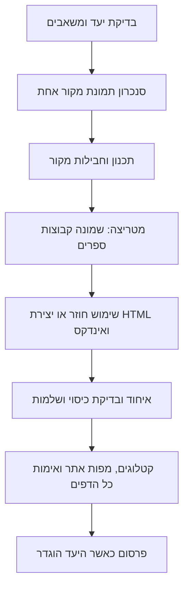

# מחקר ביצועים והחלטות מימוש

עודכן: 22 בנובמבר 2026. המסקנות מבוססות על יומן הבנייה המקורי, קריאת הקוד, תיעוד ראשוני והשוואות שניתן להריץ מחדש. מספרים של אוסף הפיתוח אינם תחזית לזמן הספרייה המלאה.

## הדרישות המחייבות

- האתר והחיפוש סטטיים לחלוטין. אין שרת חיפוש, API בתשלום או מסד מקוון.
- הבנייה משתמשת במכונות Linux סטנדרטיות וחינמיות של GitHub במאגר הציבורי.
- להשקה נדרשים חיפוש טקסט, ביטוי מדויק וסינון. ניתוח שורשים וחיפוש סמנטי אינם דרישה.
- כל דפי הקריאה נשמרים כ־HTML מלא ונפרד. כתובות, מזהי מקורות, עוגנים, מהדורות, הערות, ייחוס ויכולת קריאה ללא JavaScript נשמרים.

## 1. אבחון ההרצה המקורית

[Run 44972240960](https://github.com/NHLOCAL/otzaria-web/actions/runs/44972240960), ב־commit `370048cc64098a9aa09ab2b972207f133791d634`, הסתיים בהצלחה. [עבודת הבנייה 137054363857](https://github.com/NHLOCAL/otzaria-web/actions/runs/44972240960/job/137054363857) נמשכה 1:57:06. הפרסום דולג משום שהיעד ופרטי R2 לא הוגדרו.

| שלב | זמן שנצפה ביומן |
| --- | ---: |
| סנכרון מקורות | 4:34 |
| יצירת HTML ויצוא | 19:57 |
| אינדוקס הטקסט הראשי | 78:28.8 |
| אינדוקס קטלוגים חיצוניים | 1:19 |
| חישוב גודל | כ־0:38 |
| בדיקת HTML וקישורים | 10:44.9 |
| פרסום | דולג |

האינדוקס הראשי הוא כ־67% מזמן העבודה. הסנכרון אינו צוואר הבקבוק העיקרי בהרצה זו. הגדלת מספר ההורדות המקבילות או החלפת יבואן Python לא היו מטפלות ברוב הזמן.

ביומן `df` הופיעו **105GB פנויים** אחרי ניקוי תוכנות מיותרות. הטענה הקודמת במסמך זה, שלפיה תוצר של כ־26GB חרג בהכרח מדיסק של 14GB וגרם לתקיעה, לא נתמכה ביומן והיא תוקנה. טבלת GitHub מתעדת משאבים סטנדרטיים, אך יש למדוד את המקום הפנוי במכונה שהוקצתה בפועל. המימוש החדש בודק משאבים לפני השלבים הכבדים ומפיק אבחון מפורש.

היקף הייחוס ההיסטורי: 9,799 יצואי ספרים, 378,696 דפי קריאה, 390,614 דפי HTML, ‏870,509 קבצים וכ־25.96GB. אלו נתוני הבנייה הקודמת ב־[דוח האימות](VALIDATION.md), ולא ספירה חדשה של המימוש המשופר.

## 2. מדוע נשארים עם Pagefind ו־Node

Pagefind כבר מפעיל **מנוע אינדוקס מקומי ב־Rust** דרך ממשק Node. אין הצדקה לכתוב מחדש את כל ה־renderer או את היבואן ב־Rust לפני שמטפלים בתכנון העבודה ובהעברת הנתונים למנוע הקיים. Python משתמש גם הוא בספריית zstd מקומית; רוב זמן הבנייה שנמדד אינו בפענוח הארכיון.

השוואה ל־[Hugo](https://gohugo.io/troubleshooting/performance/) ול־[בנייה במקטעים ב־Hugo](https://gohugo.io/configuration/segments/) מראה את הדפוסים השימושיים: מדידת שלבים ותבניות, עיבוד מקטעים עצמאיים ושימוש חוזר לפי תלות מפורשת. Zola מספק מחולל ב־Rust, אך מעבר אליו יחייב העתקת כללי סימון המקור, פרקי הקריאה, המהדורות והעוגנים. הוא גם אינו מחליף את עבודת Pagefind. אימצנו את שיטות העבודה בלי להוסיף מחולל חדש, שפת תבניות חדשה או שרשרת Rust נוספת לתחזוקה.

ההחלטה היא להשאיר את היבואן ואת המחולל, לשמור את הבדיקות הקיימות, ולהעביר רק את העבודה העצמאית למטריצה. אם לאחר המדידות יישאר מוקד CPU משמעותי בתוך parser הטקסט, אפשר לשקול מודול מקומי קטן עם בדיקות שקילות. אין במימוש הבטחה ש־Rust לבדו יקצר את הבנייה פי מספר מסוים.

## 3. הבנייה שהוטמעה

### חלוקה לפי תחום ומשפחת ספרים

תחום קטן שייך לעבודה אחת. רק תחומים גדולים מתחלקים לפי hash של משפחת הספר. המהדורה הראשית ומהדורותיה נשארות יחד. מספר הקבוצות לכל תחום נבחר במדרגות של חזקות שתיים, לפי נפח הטקסט. כך לא נוצרים שמונה אינדקסים זעירים לכל תחום קטן. שינוי משמעותי בגודל תחום עשוי לשנות את חלוקתו; זו פשרה גלויה בין יציבות, איזון העבודה ועלות הדפדפן.

כל עבודה מורידה רק את ארכיון המקור שלה. הקטלוג המלא נכלל כמטא־דאטה לצורך קישורים בין מהדורות, אך טקסטי הספרים האחרים, ה־PDF והקטלוג החיצוני המלא אינם משוכפלים לכל עבודה. המקורות המשותפים נשמרים בחבילה גלובלית נפרדת.

### איחוד ללא אובדן תוכן

כל חלק מסומן `partial: true` ואינו מתאים לפרסום. כל קובץ ספר מקבל SHA-256, וכל דף חיפוש מקבל hash של התוכן שאונדקס. שלב האיחוד בודק:

- שכל חלק צפוי הגיע, עם טביעת הקלט והתצורה הנכונה.
- שכל ספר וכל דף נמצאים פעם אחת בדיוק.
- שכל קובץ ספר תואם לגודל ול־SHA-256 שנרשמו, כולל פגיעה שאינה משנה אורך.
- שכל אינדקס מכיל את מספר הדפים הנכון ואת כל קובצי Pagefind ללא שינוי.
- שכיסוי האינדקס תואם בדיוק לרשימת הדפים ולתוכנם בבנייה המאוחדת.

לא מתפרסם manifest מוכן אם חסר חלק. בדיקת הפרסום עצמה דוחה גם `partial`, בנוסף לבדיקות ה־workflow. הקטלוגים, מפות האתר ודפי הכניסה נוצרים לאחר האיחוד.

### חיסכון בתוך ה־renderer

- שורות שאין בהן `<` או `&` אינן דורשות DOM של HTML. הן עוברות מסלול טקסט ישיר עם escaping זהה. תגיות, ישויות ומקרים מורכבים ממשיכים דרך parse5.
- תיקיות מוכנות נשמרות בזיכרון, במקום `mkdir` חוזר לכל דף.
- `book.json` נכתב כ־JSON קומפקטי, ללא שינוי בסכמה או בתוכן.
- גוף החיפוש מופק מאותה פונקציית `readingArticle` שמייצרת את מאמר הקריאה. הוא שומר כותרות, מסננים, מטא־דאטה, הערות ועוגנים, ומשמיט תפריטים, כלי קריאה, footer ו־JSON-LD שאינם משתתפים בחיפוש.
- קלטי החיפוש מאוגדים בקובץ JSON אחד לכל ספר. לא נוצר עותק דיסק קטן נוסף לכל אחד ממאות אלפי הדפים.

### אימות מלא במקביל

בדיקת HTML עוברת פעם אחת על ה־DOM של כל מסמך. עוגנים מקומיים נבדקים באמצעות `Set`, ורשימת קבצי היעד נאספת פעם אחת. ארבעה workers בודקים מנות קטנות של מסמכים; אין דילוג על דפים ואין דגימה במקום אימות מלא. `VERIFY_CONCURRENCY=1` מאפשר הרצה שמרנית או השוואה. דוח האימות שומר את מספר הדפים, זמן העבודה והשגיאות.

## 4. מטמון והתאוששות

יש שתי שכבות משלימות:

| שכבה | מתי ניתן להשתמש בה | גבול לכל עבודה |
| --- | --- | ---: |
| חבילת תוצאה דחוסה של חלק | אותה קבוצת קלטים, מטא־דאטה, קוד ותצורה בדיוק | 512MiB |
| אינדקס Pagefind של מקטע | אותם דפים ותוכן, URL, גרסת מנוע ואפשרויות אינדוקס | 512MiB |

פגיעה במטמון החלק מדלגת על רינדור ואינדוקס שלו. כאשר חלק השתנה, מטמון האינדקס יכול עדיין למחזר מקטעים שלא השתנו. הריצה אינה תלויה בזמינות המטמון: היעדרו או פגיעה בשלמותו גורמים לבנייה מחדש.

מפתחות האינדקס אינם כוללים `builtAt` או נתיב מוחלט של runner. הם כוללים hashes של התוכן בפועל, ולא רק את אורכו. קבלות השלמות כוללות hashes של קובצי האינדקס, ולכן קובץ שנפגם באותו מספר בתים אינו מתקבל כמטמון תקין. אפשר לחדש עבודה שנקטעה באמצעות `SEARCH_RESUME=1`.

גבול שמונה העבודות הוא עד 4GiB של חבילות תוצאה ועוד עד 4GiB של אינדקסים במחזור פעיל. אין מטמון של ארכיון המקור הגדול, ואין הגדלה של מכסת GitHub החינמית. GitHub מנהל פינוי של גרסאות ישנות; אין הבטחה שכל מקטע יישאר במטמון בין ריצות.

**מגבלה חשובה:** טביעת חלק כוללת מטא־דאטה אמיתי של המקור. גרסת מקור חדשה יכולה לעדכן כתובת release או תאריך בכל הספרים, גם אם טקסטים רבים זהים. במקרה כזה מטמון תוצרי HTML ייפסל בהתאם, ואינדקסי חיפוש שתוכנם זהה עדיין יכולים לשמש שוב. לא נטען שבכל release חדש רק ספרים עם שינוי מילים נבנים מחדש.

לכל תהליך אינדוקס יש מגבלת זמן וברירת מחדל שמרנית של זיכרון. ה־workflow מפעיל אינדקס מקומי אחד בכל עבודה. מדידת RSS כוללת את התהליכים הצאצאים, אך היא דגומה ואינה תקרת זיכרון קשיחה. ברירת המחדל העצמאית מתחשבת גם במגבלת cgroup ולא רק בזיכרון המארח.

## 5. בחירת מנוע חיפוש סטטי

| מנוע או גישה | יתרון רלוונטי | מחיר שילוב | החלטה |
| --- | --- | --- | --- |
| Pagefind | Rust לבנייה, WASM בדפדפן, ביטויים, מסננים, מקטעים לפי דרישה | דורש תכנון מקטעים ובדיקת דירוג בעברית | נשאר המנוע הראשי |
| MiniSearch | קטן ונוח לקטלוג שמות בזיכרון | אינו מספק אינדקס מיקומים לביטויים כפי שנדרש כאן; טעינת קורפוס גדול בעייתית | אינו תחליף לטקסט המלא |
| FlexSearch | workers, הקשר ואפשרויות התמדה בדפדפן | דורש תכנון הפצה, טעינה, גרסאות ודירוג חדש; אינדקס הקשר מוסיף זיכרון | לא הוחלף בלי הוכחת יתרון |
| Orama JS | מנוע טקסט זמין בדפדפן | אין במדידות שנאספו הוכחה להתאמה טובה יותר לקורפוס זה | חלופה לבדיקה עתידית ממוקדת |
| Stork | Rust ו־WASM עם ממשק סטטי | המתחזק הודיע שסיים את עבודתו הפעילה בפרויקט | אינו תלות אסטרטגית חדשה |
| SQLite FTS5 עם HTTP Range | תמיכה במיקומים ובביטויים, אחסון קומפקטי | שכבת מערכת קבצים מרוחקת, תכנון דפים וקריאות רשת | מעניין למחקר, לא החלפה מוכחת |
| Tantivy של הדסקטופ | מנוע עשיר וכללי טקסט של אוצריא | קבצים מקומיים, סכמות, fork ותלות ב־SQLite; אין חבילת דפדפן מוכנה | לא מיובא לווב |

הדגמות [MDN](https://mdn.pagefind.app/) ו־[Godot](https://godot.pagefind.app/) של Pagefind מראות חיפוש מלא בצד הלקוח. הן דוגמה לארכיטקטורה, ולא benchmark בגודל הספרייה שלנו.

Pagefind תומך בחיפוש עברי בלי לטעון שכללי stemming עבריים קיימים בו. הביטוי המדויק בממשק הוא שאילתה שלמה בתוך מירכאות כפולות, למשל `"בראשית ברא"`. לא מוצג מצג של תחביר Boolean מורכב או שילוב שרירותי של תתי־ביטויים. בדיקות מקור בוחנות ניקוד, סדר מילים, ביטוי רצוף, תחום ותוצאות ממקורות צפויים.

### טעינה וסינון בדפדפן

מניפסטים מציינים את התחומים או הספקים של כל אינדקס. הבחירה נעשית לפני טעינת נתוני האינדקס. תוצאות מקבלות את דירוג Pagefind, ותמציות נטענות רק עבור תוצאות שמוצגות בפועל. שאילתה שהתיישנה בעקבות הקלדה או החלפת תחום אינה רשאית להחליף תוצאות חדשות.

נבחנה תחילה חלוקה למופעי Pagefind נפרדים עם מקביליות מוגבלת. היא חסכה טעינה בחיפוש מסונן, אך הורידה WASM נוסף לכל מופע והגדילה את עלות האתחול בחיפוש כללי. המימוש הזה לא נבחר לדפדפן. המימוש הסופי מפעיל Web Worker אחד בבעלות האתר לכל תחום פעיל, ומפעיל בתוכו את ממשק `noWorker` המתועד של Pagefind. האינדקסים הרלוונטיים משותפים למופע WASM אחד. תור פנימי מגביל לשמונה הורדות פעילות, כולל זמן הורדת הגוף ולא רק קבלת הכותרות, בלי לשנות את `fetch` של העמוד.

החלפת תחום או ביטול עבודה פעילה סוגרים את ה־worker הישן. תוצאות עצלות קשורות לדור השאילתה, ולכן תמצית ישנה אינה יכולה לשמש תוצאה חדשה. טיפול בכשלי HTTP, רשת או פענוח בתוך ה־worker מונע תוצאות חלקיות ש־Pagefind 1.6 עלול להחזיר אחרי שהוא לוכד שגיאה פנימית. בדיקות הרגרסיה כוללות גם קובץ פגום שחזר עם HTTP 200, ולא רק שגיאת 503.

באותו אוסף בן חמישה אינדקסים, האינטראקציה הראשונה בחיפוש כללי דרשה 317,984 בתים ו־31 בקשות, לעומת 316,780 בתים ו־30 בקשות בלקוח הממזג הקודם. ההפרש הוא המניפסט הקטן, ובשניהם נטען WASM יחיד. בחיפוש תנ״ך מסונן ירדו 184,119 בתים ב־20 בקשות, לעומת 319,838 בתים ב־35 בקשות בלקוח הקודם: נטען מטא־דאטה של אינדקס תחום אחד מתוך חמישה. אלו מדידות גופי תגובה ב־worker אמיתי עם Pagefind המקורי; הן אינן זמני רשת סלולרית או benchmark של כל הספרייה.

## 6. פורמטים, דחיסה ואחסון

| שימוש | פורמט שנבחר | הסיבה |
| --- | --- | --- |
| דפי קריאה וגילוי SEO | HTML עצמאי ב־UTF-8 | כל כתובת נשמרת ונקראת ללא הרצת קוד |
| קטלוגים ופרטי ספר | JSON מדופדף או לפי ספר, קומפקטי | כלי עבודה פשוטים, סכמה גלויה וטעינה מוגבלת |
| הורדת הטקסט המלא | TXT לפי ספר | נשמר הממשק הקיים למשתמשים ולכלי ציטוט |
| קלט האינדוקס | JSON פנימי לפי ספר, ובו HTML חיפוש מצומצם | פחות פתיחות קבצים ופחות parsing בלי שינוי סמנטיקה |
| מעבר בין עבודות | `tar.zst` ברמת דחיסה 3 | חיבור קבצים קטנים לארכיון אחד ודחיסה מהירה, ללא שינוי בתוצר המוגש |
| מקטעי Pagefind | הפורמט הדחוס המקורי של Pagefind | אין שכבת דחיסה או loader חלופיים לתחזוקה |
| PDF ותמונות | הקבצים המקוריים המאומתים | לא דוחסים מחדש מדיה שכבר דחוסה |

לא הוחלפו דפי HTML במסד בינארי, ולא הוסרו קובצי TXT או מהדורות כדי להציג תוצאה קטנה יותר. לא נוספו לכל אובייקט עותקי `.gz` ו־`.br`: הדבר מכפיל את מספר האובייקטים ודורש טיפול נכון ב־Content-Encoding ובמטמון. דחיסה ברשת היא תכונת ההגשה שיש למדוד ביעד האמיתי. `_headers` אינו קובץ תצורה ש־R2 מפעיל בעצמו.

הארכיונים מועלים ל־Actions עם `compression-level: 0`, משום שהם כבר דחוסים, ונשמרים יום אחד. דוחות קטנים נשמרים יותר זמן. אחרי החילוץ הארכיון מוסר מה־runner. אי אפשר להניח שכל 26GB של `dist` מתאימים למטמון התלויות החינמי.

### פשרת מספר המקטעים

Pagefind 1.6 מאפשר `maxFragments`. יעד של 64KiB לבדו הפחית מאוד את מספר הקבצים, אבל הגדיל את הורדת 15 התמציות הראשונות בערך פי שישה באוסף הבדיקה. הגדרה זו נדחתה כברירת מחדל.

ההגדרה שנבחרה משלבת את יעד הבתים עם יעד של כשני דפים בממוצע למקטע. זו אינה מגבלת גודל קשיחה לכל מקטע, ולכן יש להמשיך למדוד גם קבצים חריגים ומכשירים חלשים. `SEARCH_FRAGMENT_TARGET_BYTES=0` מחזיר מקטע נפרד לכל דף לצורך השוואה.

## 7. השוואה לאוצריא בדסקטופ

נבדקו קוד הדסקטופ ב־`cee59520a8e6d35d5350b8f51cde322d4b4b99cf` ומנוע החיפוש ב־`44e5034c51f8ca8043fbe1bb392dc544ffbd815f`. הדסקטופ מפעיל Tantivy מקומי עם גשר Flutter, סכמות ומנגנוני אחסון שאינם חלק מהדפדפן.

| יכולת בדסקטופ | שילוב בווב |
| --- | --- |
| מזהי ספר, שורה ומהדורה | נשמרים במדויק, ומשמשים כתובות ועוגנים |
| חיפוש טקסט, ביטויים ותחום | נכללים בגרסת הווב ונבדקים מול מקור |
| הצגת קטע ותנועה למקור | תמציות עצלות וקישור לדף המקורי עם הדגשה |
| מהדורות, הערות וקשרים | נשמרים בתוכן ובקובצי הנתונים; אין צורך להעתיק את כל ממשק הדסקטופ |
| הרחבות איות, regex, מרחק מילים וחיפוש עמום | מחוץ לדרישות ההשקה; לא מיובאים כמערכת נוספת |
| קרי וכתיב באותו מיקום וכללי גרשיים של tokenizer | אין הצהרת שקילות אוטומטית; נדרשות בדיקות עברית ייעודיות לפני הרחבה |
| ONNX וחיפוש סמנטי | אינם נכללים: מודלים, וקטורים ועלות הפצה אינם נחוצים למטרה |
| עדכון writer מקומי, SQLite ומסדי Tantivy | מוחלפים בפרסום סטטי מאומת של אינדקסים מוכנים |
| קוראי PDF ואינדוקס קבצים במכשיר | ה־PDF הרשמי נשמר כקובץ; אין מנגנון OCR או יבוא מרוחק נוסף |

חוב טכני נשמר נמוך באמצעות מנוע אחד, אותם מזהי מקור, אותה פונקציית HTML לקריאה ולאינדוקס, ואותן בדיקות שקילות. אין ניסיון לשכפל את מלוא מוצר הדסקטופ בדפדפן.

## 8. מדידות והשוואות שנעשו

המדידות הבאות הן מקומיות, על 60 יצואי ספרים אמיתיים ובהם 1,545 דפי קריאה. מדובר בהרצות על אותו מחשב ובאותו קלט, ולא בנתוני CDN או בטלפון.

| בדיקה | לפני | אחרי | פירוש |
| --- | ---: | ---: | --- |
| אינדוקס יחיד, HTML מלא לעומת מצומצם | 6.180 שניות | 4.840 שניות | כ־21.7% פחות זמן בהרצה זו |
| זהות תוצר האינדקס באותה השוואה | 1,643 קבצים | 1,643 קבצים זהים ב־SHA-256 | נשמרו נתוני החיפוש והעוגנים |
| מספר קובצי האינדקס, אותם 5 מקטעי תחום | 1,699 | 927 | כ־45.4% פחות עם איגוד שמרני |
| נפח אותם אינדקסים | 8,707,969 בתים | 8,375,750 בתים | כ־3.8% פחות |
| הורדת 15 תמציות באותה שאילתה | 31,092 בתים | 53,163 בתים | תוספת צפויה בעקבות האיגוד |

בדיקת רינדור השוותה 1,665 קובצי HTML ו־TXT של ספרים מול הקוד הקודם: כולם זהים ברמת הבתים. מבני JSON שקולים למרות הסרת הרווחים. בדיקת המטריצה יוצרת ארכיונים אמיתיים, מוחקת את מקורות הספרים לפני האיחוד, בודקת חלק חסר ופגיעה באותו אורך, ומשווה את כל ה־HTML וה־TXT לבנייה רציפה. היא רצה בשני base paths.

בנוסף נבדקו עשרים קובצי המקור הגדולים בספרייה המלאה: 627,046,916 בתים, כ־9.35% מנפח המקור, ו־1,038,237 tokens של parser המקור. כל תוצאות הפענוח זהות ב־SHA-256 לקוד הקודם. זמן הפענוח המצטבר ירד מ־22.646 ל־9.494 שניות, כ־58.1% פחות בהרצה המקומית. סדר המימושים הוחלף בין ספרים ונעשתה פעולת GC בין מדידות; קריאת הקובץ, חישוב hash ו־GC אינם בתוך זמן הפענוח. בניית HTML אחרת רצה באותו מחשב, ולכן זהו אבחון של ה־parser ולא הוכחה לקיצור מקביל בזמן הבנייה הכולל.

בדיקת חיפוש ייעודית בונה תשעה אינדקסים אמיתיים. היא גילתה תחרות באתחול מופעי WASM מקבילים שהשמיט תוצאה, ולכן נשמרה כבדיקת רגרסיה. בדיקות ממוקדות כוללות גם מטמון חם, שינוי תוכן, שינוי מטא־דאטה, החלפת תצורה, חידוש עבודה, קבצים פגומים ומקטעים חסרים.

תוצאות ההרצה המלאה המעודכנת יירשמו בנפרד עם SHA, קישור ל־Actions ופירוט זמני השלבים. אין להסיק שהזמן הכולל מתחלק בשמונה: העברת ארכיונים, תורים, איזון קבוצות ואיחוד מוסיפים עבודה.

המדידות הגולמיות ושיטת ההשוואה נשמרות ב־[performance-experiments.json](validation/performance-experiments.json). בדיקות דפדפן אוטומטיות הן שער נפרד ב־CI. בסביבת העבודה המקומית הורדת Chromium נחסמה ב־HTTP 403, וגם Chromium מותקן לא קיבל הרשאה לפתוח socket; אין להציג את בדיקות ה־worker של Node כאילו הן בדיקות UI בדפדפן.

## 9. מקורות ראשוניים

נבדקו תיעוד ומקורות קוד, ולא הועתקו הבטחות ביצועים שיווקיות למאגר שלנו.

1. [Pagefind Node API](https://pagefind.app/docs/node-api/), [אפשרויות אינדוקס](https://pagefind.app/docs/config-options/), [ריבוי אינדקסים](https://pagefind.app/docs/multisite/) ו־[שפות](https://pagefind.app/docs/multilingual/).
2. [Pagefind 1.6.0, API בדפדפן](https://github.com/Pagefind/pagefind/blob/v1.6.0/pagefind_web_js/lib/public_search_api.ts), [מימוש החיפוש](https://github.com/Pagefind/pagefind/blob/v1.6.0/pagefind_web_js/lib/coupled_search.ts) ו־[כתיבת התוצרים ב־Rust](https://github.com/Pagefind/pagefind/blob/v1.6.0/pagefind/src/output/mod.rs).
3. [GitHub: מכונות סטנדרטיות](https://docs.github.com/en/actions/reference/runners/github-hosted-runners), [מגבלות](https://docs.github.com/en/actions/reference/limits), [מטמון ופינוי](https://docs.github.com/en/actions/reference/workflows-and-actions/dependency-caching) ו־[חיוב Actions](https://docs.github.com/en/billing/concepts/product-billing/github-actions).
4. [actions/upload-artifact](https://github.com/actions/upload-artifact), לרבות רמת דחיסה ושמירת תוצרים.
5. [Hugo: מדידה](https://gohugo.io/troubleshooting/performance/), [מקטעי בנייה](https://gohugo.io/configuration/segments/) ו־[תבניות במטמון](https://gohugo.io/functions/partials/includecached/); [תבניות Zola](https://www.getzola.org/documentation/templates/overview/).
6. [MiniSearch](https://github.com/lucaong/minisearch) ו־[דיון המחבר על ביטויים מדויקים](https://github.com/vuejs/vitepress/issues/2731); [FlexSearch](https://github.com/nextapps-de/flexsearch); [Orama JS](https://docs.orama.com/docs/orama-js); [מצב Stork](https://stork-search.net/).
7. [SQLite FTS5](https://www.sqlite.org/fts5.html), [sql.js-httpvfs](https://github.com/phiresky/sql.js-httpvfs) ו־[דיון מפתחי הפרויקט על דירוג ותעבורת FTS5](https://github.com/phiresky/sql.js-httpvfs/issues/10).
8. [תיעוד החיפוש של אוצריא, revision קבוע](https://github.com/Otzaria/otzaria/blob/cee59520a8e6d35d5350b8f51cde322d4b4b99cf/docs/search_documentation.md), [tokenizer עברי](https://github.com/Otzaria/otzaria_search_engine/blob/44e5034c51f8ca8043fbe1bb392dc544ffbd815f/rust/src/hebrew_tokenizer.rs), [גבול הספרייה המקומית המשותפת](https://github.com/Otzaria/otzaria_search_engine/blob/44e5034c51f8ca8043fbe1bb392dc544ffbd815f/rust/core/README.md).

## 10. מגבלות ותנאי השלמה

השיפור אינו משנה את העובדה שחיפוש בכל 6.7GB של טקסט דורש נתוני אינדקס וזיכרון בצד הלקוח. חיפוש בתחום מצומצם יכול לחסוך משמעותית, אך אין כאן הבטחה שכל שאילתה תצרוך מעט נתונים או שמכשיר חלש יחזיק את כל האינדקס בזיכרון. דירוג תוצאות תלוי במנוע ובחלוקת האינדקסים, ולכן נדרש להרחיב את אוסף שאילתות האיכות לפני שינוי משקלים.

הפרסום ל־R2 נשאר תלוי בהגדרת יעד ודומיין. המימוש מונע המתנה של שעתיים שבסופה מתגלה לראשונה שאין יעד, אך אינו יוצר חשבון או מפתח API. אין כאן תוצאת פריסה חיה, בדיקת סריקה של Google או מדידת ביצועים ממכשיר נייד ברשת סלולרית.
