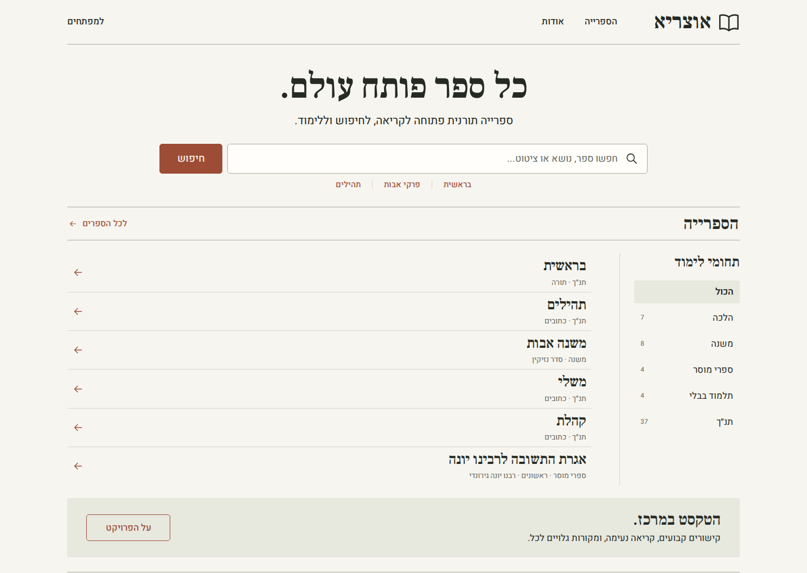
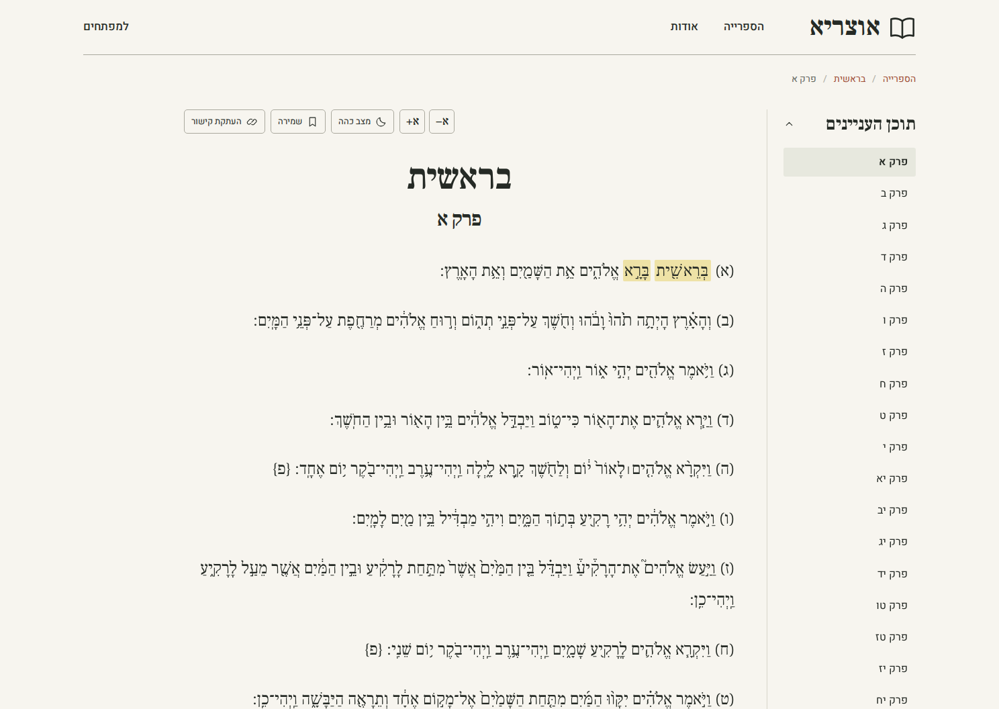
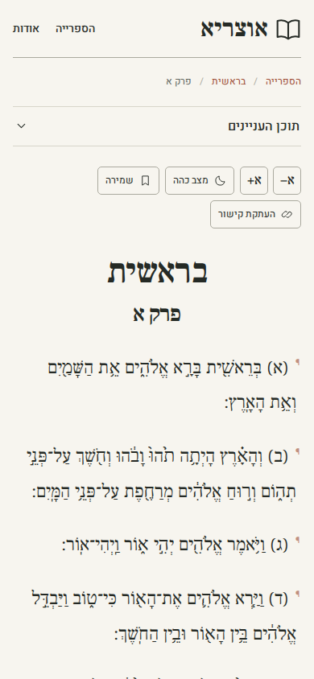

# סקירת הממשק ובדיקות הדפדפן

הצילומים כאן נוצרו ב־Chromium מול האתר שנבנה בפועל ב־GitHub Actions, מתוך **ערכת הפיתוח `starter`** הכוללת ספרים שלמים ומהדורות אמיתיות. תוצאות הבדיקה מתייחסות לערכת פיתוח זו.

**14 מתוך 14 בדיקות הדפדפן עברו**, ללא שגיאות JavaScript, אזהרות בדפדפן או בקשות לקבצים שנכשלו. [הרצת CI מ־22 בנובמבר 2026](https://github.com/NHLOCAL/otzaria-web/actions/runs/44964436288), עבור קומיט `b6641ca667ad0f1aa6299886e76975fd4e6aec27`.

## מה נבדק

- חיפוש בטקסט המלא, התאמה בין שאילתה מנוקדת לשאילתה ללא ניקוד, ביטוי מדויק במרכאות, סינון לפי תחום ומצב ללא תוצאות. החיפוש רץ מול שלושה אינדקסים סטטיים מאוחדים.
- מעבר מתוצאה לספר וסימון מילות החיפוש בטקסט מנוקד. חיפוש הביטוי המדויק ״בראשית ברא״ החזיר את חמש המהדורות העבריות שבערכת הפיתוח.
- הגדלת אותיות מ־25 ל־27 פיקסלים, שמירת הגודל והמצב הכהה לאחר טעינה מחדש, סימנייה הנגישה מעמוד הבית והמשך מהמקום האחרון בספר.
- קריאת בראשית פרק א ללא JavaScript: 31 פסקאות, כולל הפסוק הראשון והאחרון, ומעבר תקין לפרק ב באמצעות קישור רגיל.
- טעינת הגופנים המקומיים, תוכן עניינים נפתח בנייד והיעדר גלילה אופקית בעמודי הבית והקריאה שנבדקו.

| תצוגה | רוחב × גובה החלון | רוחב המסמך שנמדד |
| --- | --- | --- |
| מחשב | 1,488 × 1,056 פיקסלים | 1,488 פיקסלים |
| נייד | 390 × 844 פיקסלים | 390 פיקסלים |

## עמוד הבית במחשב

## קריאה במחשב

תוכן העניינים מופיע לצד הטקסט. כלי הקריאה מאפשרים לשנות את גודל האותיות, לבחור מצב כהה, לשמור את הדף ולהעתיק קישור. הצילום מציג הדגשה של מילים שהגיעו משאילתת חיפוש.

## קריאה בנייד

תוכן העניינים ניתן לפתיחה ולסגירה, וכלי הקריאה מסתדרים בשורות בהתאם לרוחב המסך. הצילום מציג את אזור הקריאה לאחר פתיחה וסגירה של תוכן העניינים.

שלושת הצילומים הועתקו מתוצרי ההרצה ללא עריכה או שינוי גודל. בדיקות הדפדפן נמצאות ב־[tests/browser.mjs](../tests/browser.mjs); שאר הצילומים והדוח המפורט צורפו להרצת ה־CI כ־`browser-evidence`.
